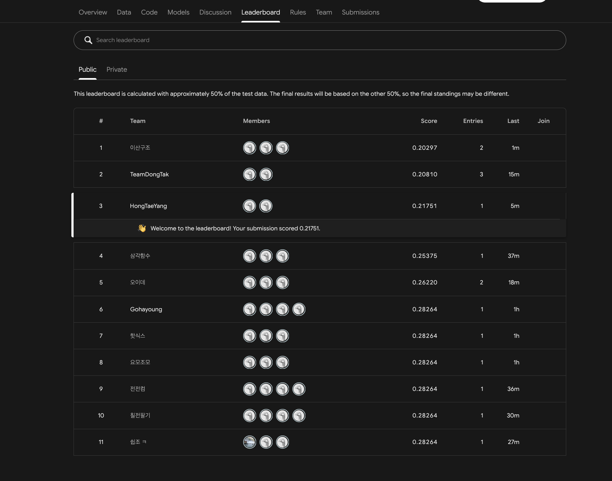
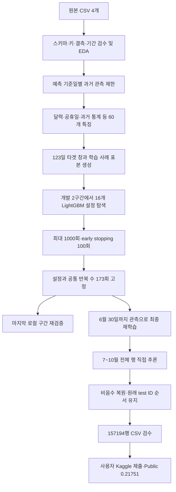
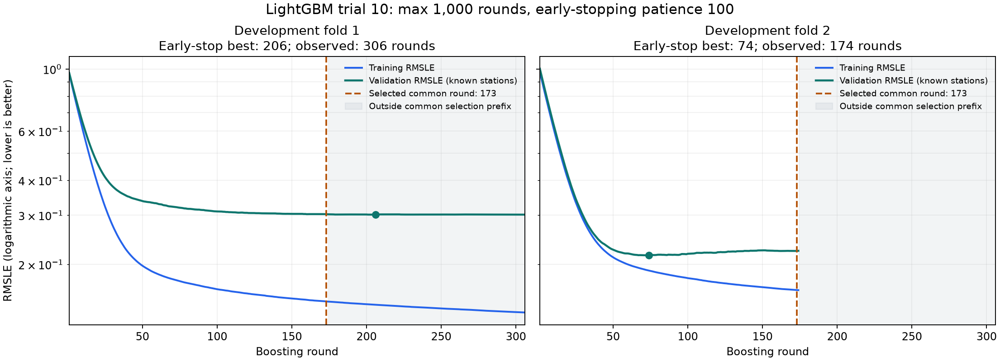

# SINCON 2026 현재 제출 파이프라인 전체 정리

작성일: **2026-11-11 KST**  
작업 폴더: `/Users/hongtaeyang/Desktop/SINCON`  
대상: **Public RMSLE 0.21751을 기록했다고 사용자가 확인한 제출 모델**

## 1. 제출 결과와 현재 구성

| 항목 | 현재 상태 |
|---|---|
| Kaggle Public RMSLE | **0.21751** |
| 마지막 로컬 비교 RMSLE | **0.24780832863461** |
| 제출 모델 | LightGBM GBDT 단일 모델 |
| 최종 트리 수 / 최대 리프 수 | **173 / 127** |
| 특징 수 / 최종 학습 사례 수 | **60 / 220,000** |
| 추가 후처리 | 없음. 기본 비음수 복원만 적용 |
| 제출 파일 | [submission_lgbm_0.247808.csv](submission_lgbm_0.247808.csv) |
| 모델 파일 | [model_bundle.joblib](outputs/lightgbm_tuned/model_bundle.joblib) |
| 적용 설정 | [lightgbm_tuned.json](configs/lightgbm_tuned.json) |

사용자가 제출 결과를 0.21751이라고 알렸고, 첨부한 Kaggle **Public** 리더보드 화면에서 `HongTaeYang`, 점수 `0.21751`, 제출 1회, 당시 3위가 확인된다. 순위는 **첨부 화면 시점의 기록**이며 현재 실시간 순위라는 의미가 아니다. 스크린샷에는 제출 파일명·제출 ID가 없으므로 특정 CSV와의 연결은 사용자의 제출 결과 설명에 근거한다. Private 점수는 확인되지 않았다.



로컬 점수는 2026년 2~6월 학습 자료 내 검증이고, Public 점수는 2026년 7~10월 비공개 테스트의 일부 날짜다. 서로 다른 표본이므로 Public 점수가 더 낮다는 사실을 같은 검증셋에서의 추가 개선으로 계산하지 않는다. 파일명 `0.247808`은 **로컬 점수**를 뜻한다.

제출 CSV SHA-256:

```text
b194efc10ba25bd362c3eddff6a0123354e6baa27f3f1e58e9faf7b1b403e5e4
```

## 2. 해결 과제·평가 지표·데이터 사용 범위

2026-06-30을 예측 기준일(origin)로 정하고, **2026-07-01~10-31의 123일 전체를 한 번에 예측**한다. 단위는 날짜 × 역 × 한 시간 구간이며, 인천 지하철 1·2·7호선 71역, 06~23시 시작 구간 18개가 대상이다. 전체 예측 행 수는 `123 × 71 × 18 = 157,194`다.

타겟은 승차 인원 `boardings`다. `alightings`는 과거 특징 생성에 사용하며 미래의 실제 하차량은 입력으로 쓰지 않는다. 예측을 다음 날 입력에 다시 넣는 재귀 예측이 아니라, 예측 날짜와 horizon을 입력하는 **공통 모델의 직접 다중 시점 예측**이다.

공식 평가지표는 낮을수록 좋은 RMSLE다.

$$
\mathrm{RMSLE}=\sqrt{\frac1N\sum_{i=1}^N[\log(1+\hat y_i)-\log(1+y_i)]^2}.
$$

학습 타겟을 `z = log1p(boardings)`로 바꾸고 회귀 L2 손실을 사용해 지표와 맞춘다. 여기에 트리 규제가 적용된다. 추론 복원은 `expm1`이며, 로그 출력이 음수면 0으로 제한한다.

공식 안내상 Public은 월마다 나눈 61일, Private은 나머지 62일이다. 하루 제출은 팀 기준 10회, 최종 선택은 2개이며 초기화는 09:00 KST다. 대회 자체의 별도 실행 시간 제한은 없고 Kaggle/Colab에서 실행 가능한 규모여야 한다. 플랫폼의 세션·GPU 할당량은 별도 조건이다.

외부 자료는 예측 기준일까지 공개돼 알 수 있던 정보만 허용된다. 실제 사용한 외부 정보는 출처를 기록한 사전 발표 공휴일뿐이다. 미래 승하차·실측 날씨·행사 결과·비공개 정답과 외부 사전학습 가중치는 사용하지 않았다. 원 데이터의 라이선스 표기는 CC BY-SA 4.0이다. [규정·출처](reports/official_sources.md), [제공된 규칙 원문](reports/sources/rules_user_provided.txt).

## 3. 전체 처리 흐름



## 4. 데이터 구조와 EDA 결과

| 파일 | 실제 크기 | 역할 |
|---|---:|---|
| `train.csv` | 688,176 × 5 | date, station_id, hour, boardings, alightings |
| `test.csv` | 157,194 × 4 | example_id, date, station_id, hour |
| `metaData.csv` | 71 × 5 | 역 ID·이름·노선·관측 시작/종료일 |
| `sample_submission.csv` | 117,576 × 2 | 로컬에 있던 오래된 제출 양식 |

학습 기간은 2025-01-01~2026-06-30의 546일이다. 역 수는 1호선 33개, 2호선 27개, 7호선 11개다. 같은 이름도 ID가 다르면 별도 역으로 취급한다.

### 관측 규칙성과 결측

- 원본 열의 결측, 날짜·역·시간 중복, train/test 키 중복, test ID 중복은 없다.
- 68역은 2025-01-01부터, 3107·3108·3109의 3역은 2025-06-28부터 관측된다.
- 모든 역이 첫날부터 있었다고 가정한 격자에는 9,612행이 없지만, 이는 세 역의 관측 시작 이전이다. **0명으로 채우지 않았다.**
- 각 역의 실제 관측 기간 내부에는 빠진 시간 구간이 없다.
- 일중 간격은 1시간, 전날 23시에서 다음 날 06시까지는 7시간이다. 미제공 00~05시를 새로 만들거나 0명으로 채우지 않는다.
- test는 71역 × 123일 × 18시간의 완전한 격자이며, 학습에 없던 역은 없다.
- metadata의 first_date/last_date는 관측 범위다. 공식 개통·폐역일로 해석하지 않고, 특징의 관측 이력은 해당 기준일 이전 실제 기록으로 다시 구한다.

### 타겟 분포와 패턴

| 승차 인원 통계 | 값 |
|---|---:|
| 평균 / 중앙값 | 331.984 / 240 |
| 최소 / 최대 | 0 / 10,189 |
| 표준편차 / 왜도 | 333.808 / 2.965 |
| 99% 분위수 | 1,755 |
| 0명 관측 | 76행, 약 0.0110% |

오른쪽 꼬리와 큰 급등이 있어 로그 타겟을 사용했다. 급등을 오류라고 단정해 제거하거나 타겟 상한으로 자르지 않았다. 시간별 평균은 07시 약 658명, 08시 약 633명으로 출근 구간이 높고, 17~18시에도 수요가 높다. 금요일 평균은 약 381명, 토요일 278명, 일요일 207명으로 요일 차이가 있다. 이 수치는 전체 EDA 요약이며 CV 특징은 각 origin 이전 관측으로 따로 만든다.

날씨·휴일·할인·좌표·인접 행렬은 원본에 없다. 공휴일만 사전 발표 자료로 보완했다. 역 간 일별 수요 상관은 높지만, 좌표·물리적 거리·전파 지연을 확인할 정보가 없어 공간 그래프 모델이나 인접 역 특징을 사용하지 않았다. 상관을 물리적 인과관계로 해석하지 않았다. [전체 EDA](reports/EDA.md), [정량 결과](reports/eda.json).

### 제출 양식 불일치

원본 sample에는 7~9월 92일만 있어 10월 39,618행이 빠져 있다. 공식 안내와 test를 기준으로 **157,194개 전체 ID를 원래 순서대로 출력**했다. sample의 0은 정답·학습 타겟으로 사용하지 않았다. `template_diagnostic_DO_NOT_SUBMIT.csv`는 불일치 확인용이다.

## 5. 전처리와 누수 방지

구현: [features.py](src/features.py), [holiday_calendar.py](src/holiday_calendar.py).

1. Polars `scan_csv`로 읽고 필요한 숫자 열을 int32로 축소한 뒤 pandas로 특징을 만든다. 모든 작업이 Polars 지연 연산인 것은 아니다.
2. date를 datetime으로 변환하고 스키마·키·비음수 관측·학습/테스트 기간 분리를 검사한다.
3. `hist = history[date <= origin]`으로 과거를 제한한다. 모든 통계·시차·관측 이력은 이 자료에서 계산한다.
4. 원본 스케일을 유지한다. 트리에 표준화·MinMax scaling·RevIN을 적용하지 않는다.
5. 원본 셀 결측은 없지만, 신규 역·짧은 이력·전년 값 부재 때문에 파생변수 NaN은 생긴다. 일반 특징의 NaN은 LightGBM에 그대로 전달한다. 기준선 특징에만 명시적인 대체 순서를 적용한다.
6. 최종 특징 행렬은 float32로 저장한다. 그중 `station_id`, `canonical_line`, `hour`, `dow`는 LightGBM에 범주형으로 명시한다. example_id와 station_name은 입력 특징이 아니다.
7. 병합 전 행 순서를 기록하고 병합 후 복원한다. 제출 ID와 특징 행의 대응이 바뀌지 않도록 한다.

공휴일은 날짜뿐 아니라 `known_since`를 기록하고 `as_of=origin`에 알려졌던 사실만 노출한다. 역사적 검증 시점 이후에 발표된 임시공휴일을 과거 모델이 미리 알지 않게 한다. 최종 예측에서는 2026-06-30까지 알려진 날짜를 사용한다. 실제 학습 특징의 승하차 집계에서는 공휴일 관측도 포함하고, 달력 특징으로 구분한다. **과거 공휴일 제외 집계는 채택하지 않은 추가 후처리 실험에서만 사용했다.** [공휴일 출처](reports/holiday_sources.md).

## 6. 60개 특징의 구성과 계산

`o`는 예측 기준일, `d`는 예측 날짜다. 과거 통계 창 W일은 `o-W < date <= o`로 정의한다.

| 특징군 | 개수 | 내용 |
|---|---:|---|
| 기본 ID·달력·예측 거리 | 10 | station_id, hour, dow, canonical_line, horizon, month, day_of_month, day_of_year, date_index, weekend |
| 공휴일·휴일 주변 | 12 | 공휴일 여부/유형, 대체·임시·선거·음력·노동절, 주말·휴일·전날·다음날·징검다리 |
| 주기 sin/cos | 6 | hour/24, dow/7, day_of_year/365.25 |
| 관측 이력 | 2 | history_days, cold_start |
| 역×시간×요일 이동 통계 | 15 | 28·56·112일별 승차 평균·중앙값·표준편차, 하차 평균, 관측 수 |
| 최근 역×시간 통계 | 3 | 28일 승차 평균·표준편차, 하차 평균 |
| 노선·전체 기준 통계 | 2 | 28일 노선×시간×요일 중앙값, 전체 시간×요일 중앙값 |
| 과거 시점·전년 참조 | 6 | seasonal7, seasonal7_alight, origin_lag_1/7/28, year364 |
| 비율·대체 기준선 | 4 | trend_28_112, boarding_alighting_ratio, baseline, weekday_mean |
| 합계 | **60** | 저장 모델의 실제 특징 순서와 일치 |

주요 정의:

- `horizon = (d-o).days`: 1~123. `date_index`는 2025-01-01부터의 경과 일수다.
- `history_days`: 기준일까지 관측된 역의 첫 관측일과 기준일의 차이 +1. 이력이 없으면 NaN, cold_start=1이다.
- `seasonal7`: 예측 날짜와 요일이 같은 **기준일 이전 가장 최근 날짜**의 승차량. 123일 동안 실제 미래 승차량을 가져오지 않고 마지막 관측 주의 요일 패턴을 참조한다. 하차량도 같은 방식이다.
- `origin_lag_1/7/28`: 코드상 `o-(k-1)` 날짜의 같은 역·시간 승차량이다. 즉 lag_1은 o 당일, lag_7은 o-6일, lag_28은 o-27일이다. **예측 날짜 d에서 1·7·28일을 뺀 값이 아니다.**
- `year364`: d-364일의 같은 역·시간 승차량. 참조일이 o 이후면 사용하지 않는다. 364일은 52주로 요일을 맞춘다.
- `trend_28_112 = board_mean_28 / max(board_mean_112,1)`.
- `boarding_alighting_ratio = board_mean_56 / max(alight_mean_56,1)`.
- `baseline`: 역×시간×요일의 56일 승차 중앙값 → 노선×시간×요일 중앙값 → 전체 시간×요일 중앙값 → 기준일까지 전체 승차 중앙값 순으로 결측 대체한다.
- seasonal7 결측과 weekday_mean의 56일 평균 결측은 baseline으로 대체한다. 기준선은 현재 **LightGBM의 입력 변수**이며 별도 모델로 앙상블하지 않는다.

실제 저장 순서:

```text
01. station_id
02. hour
03. dow
04. canonical_line
05. horizon
06. month
07. day_of_month
08. day_of_year
09. date_index
10. weekend
11. is_holiday
12. holiday_type
13. is_substitute_holiday
14. is_temporary_holiday
15. is_election_day
16. is_lunar_holiday
17. is_labor_day
18. calendar_is_weekend
19. is_rest_day
20. is_holiday_eve
21. is_after_holiday
22. is_bridge_day
23. hour_sin
24. hour_cos
25. dow_sin
26. dow_cos
27. day_of_year_sin
28. day_of_year_cos
29. history_days
30. cold_start
31. board_mean_28
32. board_median_28
33. board_std_28
34. alight_mean_28
35. n_28
36. board_mean_56
37. board_median_56
38. board_std_56
39. alight_mean_56
40. n_56
41. board_mean_112
42. board_median_112
43. board_std_112
44. alight_mean_112
45. n_112
46. recent_mean
47. recent_std
48. recent_alight
49. line_median
50. global_median
51. seasonal7
52. seasonal7_alight
53. origin_lag_1
54. origin_lag_7
55. origin_lag_28
56. year364
57. trend_28_112
58. boarding_alighting_ratio
59. baseline
60. weekday_mean
```

## 7. 학습 사례 생성과 시간순 CV

단순히 원본 688,176행을 한 번에 입력하지 않는다. 여러 과거 origin에서 당시 알 수 있던 정보로 123일 뒤까지 예측하는 사례를 만든다.

- 첫 학습 origin은 2025-01-28이다. 이후 28일 간격으로 생성한다.
- 학습 cutoff가 c이면 학습 origin은 최대 `c-123일`까지 허용한다. 마지막 정확한 경계일을 추가한다.
- 각 origin 뒤 123일의 실제 타겟을 학습 라벨로 사용하되, 라벨 구간 전체가 c 이전에 끝나야 한다.
- 시드 2026으로 origin별 표본을 균등 배분한다. 최종 학습은 16개 origin × 13,750행 = 220,000개 사례다.
- 마지막 학습 origin은 2026-02-27, 라벨 종료는 2026-06-30이다. 6월까지의 관측으로 최종 학습하고 추론 특징은 6월 30일 origin에서 다시 만든다.
- 표본 추출은 학습 행 수를 줄이기 위한 것이며 검증을 무작위 분할한 것이 아니다. 서로 다른 origin에 동일 타겟 행이 등장할 수 있으나 입력의 관측 시점이 다르다.

| 구간 | 예측 기준일 | 검증 날짜 | 전체 행 | 설정 선택에 사용한 행 |
|---|---|---|---:|---:|
| 개발 1 | 2025-06-26 | 2025-06-27~10-27 | 157,140 | 기존 역 150,552 |
| 개발 2 | 2025-10-27 | 2025-10-28~2026-02-27 | 157,194 | 157,194 |
| 마지막 비교 | 2026-02-27 | 2026-02-28~06-30 | 157,194 | 0 |

개발 1에는 기준일 이후 처음 등장하는 3역의 6,588행이 있다. 실제 테스트에는 이력이 전혀 없는 역이 없으므로 현재 설정 탐색에서는 이를 제외했다. 전체 역 결과는 별도로 보관한다. 신규 역을 원본에서 삭제하거나 0명으로 대체한 것은 아니다.

초기 실험부터 마지막 비교 구간을 여러 번 분석했으므로 이 구간은 **재사용 검증**이다. 현재 하이퍼파라미터·반복 수 계산에는 이 구간 정답을 사용하지 않았지만, 전체 연구 과정까지 포함해 새로운 독립 holdout이라고 주장하지 않는다. [학습 origin 기록](outputs/lightgbm_tuned/final_training_origins.json).

## 8. 모델 선정·학습 설정·early stopping

LightGBM은 AdamW를 사용하지 않는다. GBDT가 gradient/Hessian을 이용해 리프 기준 분할과 트리 출력을 순차적으로 적합한다. 이전 소형 MLP에만 AdamW가 있었다. 현재 제출에는 MLP·CatBoost·XGBoost가 포함되지 않는다.

고정된 16개 후보에서 학습률, 리프 수, 최소 리프 표본, 깊이, L1/L2 규제, 행/특징 샘플링, 분할 이득 하한을 비교했다. 기존 설정도 후보에 포함했다. [전체 후보](outputs/lightgbm_tuned/search_results.csv).

| 탐색 제어 | 값 |
|---|---|
| 최대 반복 | 1,000 boosting rounds |
| 조기 종료 patience | 100회 |
| 최소 개선량 | RMSLE 0.00001 |
| 기록 지표 | 학습·검증 RMSLE 각각 |
| early stopping 기준 | 검증 RMSLE만 사용 |
| 범주형 | station_id, canonical_line, hour, dow |
| 계산 환경 | CPU 4스레드, 시드 2026 |

기본 회귀 지표는 `metric='None'`으로 끄고, 로그 타겟에 `sqrt(mean((max(pred_log,0)-y_log)^2))`를 계산하는 사용자 지표를 사용한다. 실제 제출의 0 절삭·로그 복원과 일치하도록 한 것이다.

선정 후보 10번은 개발 1 best=206회, 실제 관찰 306회였고 개발 2 best=74회, 관찰 174회였다. 각 구간에서 100회 연속 유의미한 개선이 없어 1,000회 이전에 종료했다.

두 구간이 공통으로 기록된 **1~174회**에서 `sqrt(sum(n_k × RMSLE_k(t)^2)/sum(n_k))`가 가장 낮은 **173회**를 선택했다. fold별 best iteration의 평균을 쓴 것이 아니다. 최종 개발 합산 RMSLE는 약 0.265038335이며 설정 선택에 사용된 점수다.

최종 재학습에는 선택된 173회를 고정했다. 최종 전체 학습 자료에서 테스트 정답을 검증셋으로 만들어 다시 early stopping하지 않는다. 최대 1,000회는 탐색 상한이고 최종 트리 수와 구별한다. early-stopped 모델이 자체 best까지만 트리를 보유할 수 있어, 선정한 공통 173회로 다시 학습하고 개발 점수 재현을 확인했다.

최종 적용 파라미터:

| 파라미터 | 최종 값 |
|---|---|
| `learning_rate` | `0.055` |
| `num_leaves` | `127` |
| `min_child_samples` | `80` |
| `reg_lambda` | `10.0` |
| `reg_alpha` | `0.1` |
| `max_depth` | `-1` |
| `colsample_bytree` | `0.9` |
| `subsample` | `0.75` |
| `subsample_freq` | `1` |
| `min_split_gain` | `0.0` |
| `n_estimators` | `173` |


추가 공통 설정은 `objective='regression'`, `linear_tree=False`, `random_state=2026`, `n_jobs=4`다. 규제·샘플링·조기 종료를 적용했지만 모든 트리 구조와 설정의 **전역 최적해를 보장하지 않는다**. 두 개발 구간에서 관측한 반복 범위와 16개 후보 내 최선이다.



학습·탐색·진단·제출 생성은 로컬 측정 약 247.7초였다. 패키지 설치·보고서 생성 시간은 제외한다. [학습 상세 보고서](reports/LIGHTGBM_TUNING.md).

## 9. 로컬 결과와 보조 지표

| 실험 | 마지막 동일 비교 구간 RMSLE | 현재 제출 포함 |
|---|---:|---|
| 최초 계절 복사 기준선 | 0.291005 | 아니오 |
| 최초 7후보 기반 앙상블 | 0.293853 | 아니오 |
| 이전 LightGBM Large, 220회·63리프 | 0.253973 | 아니오 |
| LightGBM·XGBoost·CatBoost 3모델 결합 | 0.258433 | 아니오 |
| 현재 LightGBM, 173회·127리프 | **0.247808** | **예** |
| 현재 모델 + 추가 후처리 | 0.249954 | 아니오 |

운영진 베이스라인은 별도 원문을 실행해 RMSLE 0.3077006623을 재현했다. 평가 기간이 2026-03-01~06-30의 122일로 위 표와 달라 같은 구간 점수로 혼동하지 않는다. [공식 베이스라인 재현](official_baseline/README.md).

현재 모델의 마지막 비교 구간 보조 지표:

| 지표 | 값 | 해석 |
|---|---:|---|
| MAE | 49.9473 | 승차 인원 단위 평균 절대오차 |
| RMSE | 124.2528 | 큰 오차의 영향 포함 |
| MBE = mean(pred−actual) | −38.6759 | 평균적으로 과소예측 |
| RMSE/MAE | 2.4877 | 큰 오차의 영향이 큼. 특정 원인의 증명은 아님 |
| 7일 계절 MASE, 계열 평균 | 1.01084 | 과거 7일 차이 오차 척도에 비해 아직 개선 여지 |
| 잔차 ACF, 1/7/28일 계열 평균 | 0.1753 / 0.2472 / 0.1547 | 잔차에 시간 구조가 남음 |

MASE의 분모는 각 기준일 이전 관측에서 계산한다. ACF는 역×시간 계열의 달력 날짜 간격으로 계산하며 역 경계를 넘겨 연결하지 않는다. horizon별, 월별, 역별 오차도 CSV로 저장했다. [지표 요약](outputs/lightgbm_tuned/audit_summary.json), [스텝별](outputs/lightgbm_tuned/fold_3/per_step.csv), [월별](outputs/lightgbm_tuned/fold_3/per_month.csv), [역별](outputs/lightgbm_tuned/fold_3/per_entity.csv).

## 10. 추론과 추가 후처리의 채택 여부

현재 제출 파일의 추론 순서는 다음과 같다.

1. 저장 bundle에서 모델, 특징 순서, 학습 cutoff, 원본 입력 해시를 불러온다.
2. 2026-06-30까지 관측으로 test 157,194행의 특징을 생성한다.
3. 저장 특징 60개의 순서가 맞는지 검사하고 LightGBM 173개 트리로 로그 예측을 계산한다.
4. `prediction = expm1(max(pred_log, 0))`으로 비음수 승차 인원을 복원한다.
5. 단일 모델 가중치 1, bias 0으로 원래 값을 유지한다. 추가 로그 왕복에 의한 수치 오차도 피한다.
6. test의 example_id 순서로 묶고 소수점 8자리 CSV를 작성한다. 정수로 반올림하지 않는다.

추가 실험에서는 전체 로그 편향, 시간·요일 잔차 보정, 28/56/112일 일반일 수요 프로필 결합, 분위수 상한을 검토했다. 총 54개 후보 중 상한 2개는 진단용이었다. 개발 1에서 적합해 개발 2에서 고른 후보는 시간×요일 보정과 최근 28일 프로필 20% 결합이었지만, 마지막 RMSLE는 **0.247808 → 0.249954**로 악화됐다.

따라서 **Public 0.21751을 기록한 파일에는 그 후처리를 적용하지 않았다.** 공휴일·폐쇄 수요 0 고정, 양의 하한 강제, 임의 상한, MBE 보정도 없다. 일반적인 비음수 복원만 유지했다. 실험 bundle은 `outputs/lightgbm_postprocessed`에 별도 보관했고 현재 모델 파일은 변경하지 않았다. [후처리 분석](reports/POSTPROCESSING.md).

## 11. 제출 검수·백업·재현성

검수 완료 사항:

- 열 이름과 순서: `example_id,boardings`.
- 157,194개 ID 전체 포함, 중복 없음, test와 순서 일치.
- NaN·무한대·음수 없음.
- 저장 모델을 표준 추론 CLI로 다시 불러와도 CSV SHA-256 동일.
- 제출 직전 원본 모델로 재추론한 파일도 동일 해시.
- 최종 예측 분포: 최소 3.4033, 중앙값 264.4680, 평균 355.3341, 최대 2845.7717.
- 누수 방지, 날짜 정렬, 계절 참조, 지표, 공휴일 공개 시점, early stopping 지표, 단일 모델 추론, 후처리 경계 조건에 대한 테스트를 수행했다. 후처리 테스트는 실험 코드에 대한 검증이며 제출 적용을 의미하지 않는다.

저장 bundle은 모델·설정·특징 순서·학습 cutoff·입력 CSV 해시를 포함한다. 입력 파일이 바뀌면 표준 추론을 중단한다. [제출 검수 JSON](submission_lgbm_0.247808.validation.json), [재로딩 검증](outputs/lightgbm_tuned/verification.json).

이전 220회 모델은 [별도 백업](archives/lightgbm_large_220_before_tuning_20261111_194707/manifest.json)에 단일 joblib·LightGBM 텍스트·당시 bundle·설정·제출 파일로 보존했다. 최초 베이스라인과 3모델 결과도 삭제하지 않았다.

## 12. 실행 명령과 코드 위치

아래 명령은 프로젝트 최상위에서 실행한다. 기존 결과를 덮어쓰지 않도록 재학습에는 새 output 폴더를 사용한다.

```bash
cd /Users/hongtaeyang/Desktop/SINCON

# 데이터 분석
.venv/bin/python -m src.eda --data-dir data/raw --out-dir reports

# 테스트
.venv/bin/python -m unittest discover -s tests -v

# 최대 1000회 + early stopping + 16개 설정 탐색 전체 재현
.venv/bin/python -m src.tune_lightgbm --config configs/three_tree.json --max-rounds 1000 --patience 100 --trials 16 --output outputs/lightgbm_tuned_repeat

# 이미 선정한 설정·173회만 재학습 (탐색을 반복하지 않음)
.venv/bin/python -m src.pipeline train --config configs/lightgbm_tuned.json --output outputs/lightgbm_fixed_repeat

# 실제 제출한 저장 모델로 추론
.venv/bin/python -m src.pipeline infer --model outputs/lightgbm_tuned/model_bundle.joblib --output outputs/submission_repeat

# 이 통합 문서 재생성
.venv/bin/python scripts/build_current_pipeline_report.py
```

`three_tree.json`은 탐색 시작 시 사용하는 역사적 데이터 분할·행 생성 설정이다. tune 명령이 LightGBM 후보를 자체 구성하므로 이 명령으로 세 모델 앙상블을 학습하는 것은 아니다.

| 코드·경로 | 역할 |
|---|---|
| [src/eda.py](src/eda.py) | 데이터 구조·분포·패턴 탐색 |
| [src/features.py](src/features.py) | 로딩·기준일 제한·60개 특징·학습 사례 생성 |
| [src/holiday_calendar.py](src/holiday_calendar.py) | 공개 시점을 반영한 공휴일 특징 |
| [src/models.py](src/models.py) | 모델 파라미터·로그 타겟 학습·복원 |
| [src/tune_lightgbm.py](src/tune_lightgbm.py) | 개발 탐색·early stopping·선정·재학습 |
| [src/pipeline.py](src/pipeline.py) | 일반 학습·저장·표준 추론·CSV 출력 |
| [src/metrics.py](src/metrics.py) | RMSLE와 보조 진단 |
| [src/validate_submission.py](src/validate_submission.py) | 제출 무결성 검사 |
| [src/postprocessing.py](src/postprocessing.py) | 미채택 후처리 실험 구현 |
| [현재 재현 노트북](notebooks/SINCON_reproduce.ipynb) | Kaggle/Colab용 소스·설정 복원 및 실행 |

Python 3.12와 [requirements.txt](requirements.txt)의 고정 버전을 사용한다. 현재 LightGBM 버전은 4.7.0이다. macOS 가상환경을 다른 운영체제로 복사하지 말고 새 환경에 의존성을 설치한다. 노트북은 코드·설정·테스트를 포함하지만 원본 데이터·모델 가중치·인증정보는 포함하지 않는다. 로컬 실행과 노트북 문법·소스 복원 검증을 완료했으며 실제 Kaggle/Colab 하드웨어에서 노트북 전체 실행은 아직 확인하지 않았다.

## 13. 현재 결과의 한계

- Public은 테스트 일부 날짜의 점수다. Private·최종 순위는 아직 확인되지 않았다.
- 마지막 로컬 구간은 여러 실험에서 재사용했다. 실험 선택 편향과 계절 차이가 남는다.
- 학습 origin별 균등 표본은 최근 타겟에 충분한 가중치를 주지 못할 수 있고 동일 타겟 사례가 중복될 수 있다.
- 미래 year364 가용률, 신규 역 이력 길이, 장기 추세의 분포가 개발 구간과 달라질 수 있다.
- 물리적 공간 연결·날씨·사전 행사 일정 등을 포함하지 않았고 급등 오차와 잔차 주기성이 남아 있다.
- 16개 후보와 조기 종료로 관측한 구간 내 선택이다. 전역 최적성이나 미래 성능을 보장하지 않는다.

현재 기준 결과는 **추가 후처리 없는 LightGBM 단독: Local 0.247808 / Public 0.21751**이다.
