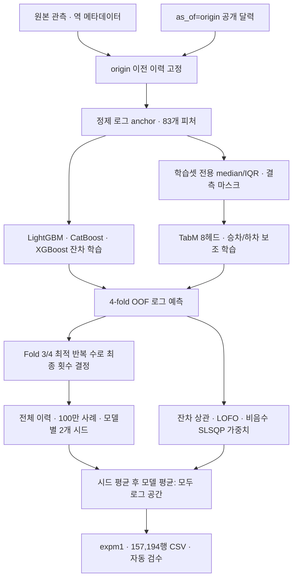

# SINCON ensemble_v2 구현 및 검증 기준

## 1. 범위와 보존

2025-01-01~2026-06-30 관측으로 2026-07-01~10-31, 71역 × 18시간 × 123일의 승차 인원 157,194개를 예측한다. 공식 평가지표는 RMSLE다. 사전학습 모델과 미래 실측 외부 자료는 사용하지 않는다. 달력은 기존 `src/holiday_calendar.py`의 `as_of=origin` 공개시점 필터를 유지한다.

현재 최고 제출 `submission_lgbm_0.247808.csv`, `outputs/lightgbm_tuned/model_bundle.joblib`, `configs/lightgbm_tuned.json`은 보존한다. 실행 시작·종료 시 `protected_sha256.json`과 비교한다. 기존 모듈의 v1 함수는 남기고 v2 구현을 별도 모듈로 분리했다. 수정 전 코드와 노트북은 `source_before/`에 보관한다.

신규 설정은 `configs/ensemble_v2.json`, 산출물은 `outputs/ensemble_v2/`를 사용한다. 입력 CSV·설정·소스 SHA-256이 이전 실행과 다르면 완료 결과를 재사용하지 않고 중단한다. 중단된 실행은 같은 해시로 다시 실행하면 완료한 모델부터 재사용한다.



## 2. 실행 환경과 실제 확인 범위

참조 환경 패키지: CatBoost 1.2.10, XGBoost 3.4.1, PyTorch 2.15.0, LightGBM 4.7.0, NumPy 2.3.5, pandas 2.2.3, SciPy 1.18.1. 제한된 환경의 사전 점검에서는 CUDA 0장, MPS 미사용으로 표시되었으나, 승인된 작업 폴더에서 전체 실행 시 MPS가 정상 감지되었다. 실제 트리 학습은 CPU 4스레드, TabM은 MPS FP32로 수행한다. 짧은 연결 점검은 CPU에서도 통과했다. CUDA FP16 분기는 구현했으나 T4에서 실행을 검증한 것은 아니다.

macOS에서 PyTorch와 LightGBM의 OpenMP 라이브러리를 같은 프로세스에 올리면 네이티브 충돌이 발생해, 장치 탐지·모델 학습·병렬 추론을 별도 프로세스로 분리했다. XGBoost 3.4의 범주형 category index는 정수로 전달한다. 원래 연속형 float32 값과 NaN은 유지한다.

실제 데이터 검수에서 XGBoost 3.4.1의 참조 범주 메타데이터를 사용한 검증 입력과 실제 추론 입력의 예측이 달랐다. 수정 전 Fold 3에서는 검증 로그 RMSE 0.216729와 저장 OOF RMSLE 0.225086이 달랐으며, 저장 OOF 점수는 실제 추론 예측으로 올바르게 계산되어 있었다. 단순히 QuantileDMatrix를 DMatrix로 바꾸는 것만으로는 차이가 사라지지 않았다. `src/xgb_compat.py`는 학습의 hist/QuantileDMatrix를 유지하고, 검증을 추가 참조 범주 변환이 없는 DMatrix로 만든다. `ResidualTree.frame()`이 학습·검증·추론의 pandas 범주 목록과 코드를 동일하게 고정하고 미지 범주는 NaN으로 처리하므로 이 경로를 사용할 수 있다. 실제 Fold 3의 20회 학습 점검에서 검증 로그와 실제 추론 잔차 RMSE 차이는 1.4e-10이었다.

이는 해당 환경·데이터에서 재현한 경로 차이이며 일반적인 XGBoost 버그로 단정하지 않는다. 공식 [QuantileDMatrix 문서](https://xgboost.readthedocs.io/en/stable/python/python_api.html#xgboost.QuantileDMatrix)는 검증용 참조 행렬을 설명한다. 기존 실행도 참조 행렬을 제공했으며, 위 수정의 근거는 로컬 재현 결과다. 수정 전 소스·모델·결과와 경로 비교는 `xgboost_validation_fix/`에 보관했다. XGBoost 4개 CV 모델과 최종 두 시드를 재학습하고, 입력·설정·피처가 같은 다른 18개 모델은 해시를 남겨 재사용했다. 소스 해시 변경을 묵인한 일반 resume이 아니라 변경 범위를 기록한 한 차례의 호환성 수정이다.

학습은 모델별 별도 프로세스로 실행하며 CPU 작업은 최대 2개(각 4스레드), MPS 작업은 1개를 동시에 수행한다. CUDA 2장에서는 LightGBM CPU 큐, CatBoost/TabM GPU 0 공유 직렬 큐, XGBoost GPU 1 큐를 사용한다. 같은 GPU의 학습 작업을 중첩하지 않는다.

## 3. Local CV와 부분 구간 학습

| Fold | 기준일 | 검증 기간 | 행 수 | 선택 가중치 |
|---|---|---|---:|---:|
| 1 | 2025-08-30 | 2025-08-31~2025-12-31 | 157,194 | 0.15 |
| 2 | 2025-10-30 | 2025-10-31~2026-03-02 | 157,194 | 0.15 |
| 3 | 2025-12-30 | 2025-12-31~2026-05-02 | 157,194 | 0.35 |
| 4 | 2026-02-27 | 2026-02-28~2026-06-30 | 157,194 | 0.35 |

합산 OOF는 628,776개 예측 사례다. 같은 날짜·역·시간이 다른 기준일에서 반복되므로 OOF 키에 fold와 origin을 포함한다. 고유 관측 628,776개라는 의미는 아니다.

학습 기준일은 2025-02-11부터 cutoff−14일까지 14일 간격이며, 간격이 맞지 않으면 cutoff−14일을 마지막에 추가한다. `origin < label_date <= min(origin+123일, cutoff)`인 사례를 후보로 사용한다. 예측 시점의 승차·하차 이력은 모두 origin에서 잘라 통계에 사용한다. 최종 cutoff는 2026-06-30이고 마지막 학습 기준일은 2026-06-16이다.

horizon 1~123을 균등한 크기의 층으로 나누고 각 층 안에서 후보를 비복원 추출한다. 행당 추출 확률에는 기준일에 따라 0.5(2025-07-01 이전), 1.5(2025-07-01~12-29), 2.5(2025-12-30 이후)를 적용한다. 동일 horizon 안의 가능한 역×시간 사례를 후보로 취급한다. 이 가중치는 샘플링 확률이며 손실함수에 다시 곱하지 않는다. 폴드당 최대 800,000행, 최종 1,000,000행을 사용한다. 원천 후보가 부족한 층은 가용 후보까지만 사용하며 실제 수는 감사 JSON에 기록한다.

주력 선택 점수는 `sqrt(sum_f fold_weight[f] * MSE_log[f]))`다. 폴드 RMSLE의 단순 가중평균과 다르다. 합산 OOF RMSLE, Fold 3+4 합산 RMSLE도 별도로 기록한다.

**가정 수정:** Fold 3·4에도 신설역의 2025년 초 관측이 없으므로 전년값 100% 가용을 가정하지 않는다. 학습·검증·테스트별 실제 비결측률을 기록한다. 공개 리더보드 점수와 Local CV는 평가 날짜가 달라 직접 동일시할 수 없다.

## 4. 정제 로그 통계와 잔차 타겟

`board_log = log1p(boardings)`, `alight_log = log1p(alightings)`를 사용한다. 과거 집계에서 당시 알려진 법정·대체·임시·선거 공휴일, 매년 5월 1일, 신설 3역(3107·3108·3109)의 2025-06-28~06-30 관측을 제외한다. origin이 2025-07-28 이후이면 계양·귤현(3110·3111)의 기저 통계는 2025-07-01 이후 관측으로 한정한다. 누락된 개통 전 행을 0으로 채우지 않는다.

예측 대상일이 공휴일이면 유효 요일 `eff_dow=6`으로 연결하고, 근로자의 날은 원래 요일을 유지한다. 정제된 과거 관측의 station×hour×eff_dow별 28·56·112일 승하차 로그 평균·중앙값·표준편차·개수를 계산한다.

56일 평균의 결측을 112일 → 노선×시간×유효요일 → 전체 시간×유효요일 순으로 대체한다. 마지막 안전망은 정제 관측 전체 로그 평균이다. 28일 평균이 없으면 대체한 56일 값을 사용한다.

`anchor_board_log = 0.6 * filled_mean56 + 0.4 * filled_mean28`

하차 anchor도 같은 방식이다. 모든 모델은 `r_board=board_log-anchor_board_log`를 학습한다. TabM의 보조 타겟은 `r_alight=alight_log-anchor_alight_log`다. 트리 모델은 `z_pred=max(0,anchor+r_pred)`로 복원한다.

anchor를 더하는 선형 복원 구간에서는 잔차 L2와 로그값 L2의 오차·그라디언트가 같다. 최종 0 clipping 경계에서는 동일한 미분이라고 할 수 없다. 잔차 타겟은 기준선 학습 부담을 줄이지만 최소 예측값·외삽·점수 개선을 수학적으로 보장하지는 않는다.

## 5. 추가 피처

- 달력 요일의 정제 56일 로그 평균, 일요일 평균과 두 평균의 차이.
- `year364_clean_log`: d−364 관측이 공휴일·개통 특수·근로자의 날이거나 없으면 d−357, d−371 순으로 정상 관측을 탐색한다. origin 이후 관측은 사용할 수 없으며 끝까지 없으면 NaN과 결측 플래그를 제공한다.
- `yoy_seas_log_delta`: 전년 목표 월의 정제 로그 평균에서 origin의 전년 동일 날짜 직전 56일 평균을 뺀다. 역×휴무 체제별 값을 사용하며 기준 창에서 역의 정제 관측일이 14일 미만이면 노선×시간×휴무 체제 변화량으로 대체한다. 노선도 없으면 0과 결측 플래그를 제공한다. 계산에 쓰이는 모든 관측은 origin 이전이다.
- 설·추석 당일/전날/다음날, 일반·대체휴일 종류, 선거, 근로자의 날, 징검다리 평일, 연휴 뒤 첫 비휴무일.
- 6/22~8/31 여름방학, 12/22~2/28 겨울방학, 3/2~3/15 및 9/1~9/14 개강 초기 피처. 실제 대학별 학사일정을 조회한 값이 아니라 사용자가 지정한 계절성 대리변수다.
- 역×시간의 과거 공휴일 로그 평균−정제 평일 로그 평균(근로자의 날·개통 특수·구조 변화 이전 관측 제외), 정제 승하차 비대칭, 최근 112일 역 내 시간대 수요 점유율, 28일−112일 로그 성장량.
- 같은 노선에서 station_id±1인 역의 anchor·성장량·anchor 차이. 실제 물리적 거리나 운행시간을 추정한 값은 아니며 역 ID 순서를 인접성 대리값으로 사용한다.
- 부평구청 3118↔3761, 인천시청 3124↔3221, 석남 3213↔3763의 상대역 anchor·성장량·로그 비율.

트리에는 float32 연속형과 NaN을 전달한다. 범주형은 station_id, canonical_line, hour, dow, eff_dow, holiday_subtype, station_hour, station_eff_dow다. XGBoost/LightGBM은 학습 때 저장한 정수 category 목록으로 변환하고, CatBoost는 문자열 category로 전달한다.

## 6. 신경망 전처리와 모델

각 fold의 학습 X에서만 중앙값·IQR·범주 목록을 추정한다. 연속형 결측은 이진 마스크를 추가한 뒤 중앙값으로 대체하고 `(x-median)/(IQR+1e-5)`를 [-10,10]으로 자른다. 범주형은 1부터 시작하며 0은 미지 범주다. 전처리기는 모델과 함께 직렬화된다.

| 모델 | 설정 | 최대 반복 / 조기 종료 |
|---|---|---|
| LightGBM | leaves159, min_child25, lr0.03, row0.8/freq1, col0.8, L1=0.5, L2=5 | 3,000 / 150 |
| CatBoost | depth8, lr0.04, l2_leaf_reg5, random_strength1, 교차 범주형 포함 | 3,500 / 150 |
| XGBoost | hist, categorical, max_cat_to_onehot4, depth8, min_child_weight20, lr0.03, row0.8, col0.75, L1=0.5, L2=5 | 3,000 / 150 |
| Multi-Task TabM | K8, hidden256, 3블록, LayerNorm/SiLU/Dropout0.15, 주파수4 | 30 epoch / 5 epoch |

세 트리는 board residual L2/RMSE로 학습·조기 종료한다. 이 값은 clipping 전 전체 로그 RMSE와 같다. 보고 점수는 clipping 후 실제 인원수 예측의 RMSLE다. 트리는 AdamW를 사용하지 않는다.

TabM은 공식 외부 TabM 패키지를 그대로 복제한 모델이 아니라 요청된 순수 PyTorch BatchEnsemble 계열 구현이다. 연속형 원변수에는 학습 가능한 주파수로 sin/cos 임베딩을 적용하며, 결측 마스크는 명시적인 이진 입력으로 붙인다. 범주형에는 Embedding을 적용한다. 각 블록은 입력 rank-1 곱셈 어댑터, 공유 Linear, 출력 rank-1 곱셈 어댑터와 바이어스, LayerNorm/SiLU/Dropout을 갖는다. 출력은 `(batch,8,2)`다.

손실은 각 헤드에서 `MSE(board residual)+0.2*MSE(alight residual)`를 계산한 다음 8개를 평균한다. 예측 평균을 먼저 내서 손실을 계산하지 않는다. AdamW lr=0.001, weight_decay=0.0001, batch=4096, CosineAnnealingLR, gradient norm 최대 5를 사용한다. 검증은 실제 승차 로그 RMSLE로 조기 종료한다.

CUDA에서는 FP16 autocast와 GradScaler를 사용하고, MPS/CPU는 FP32로 실행한다. 추론에서는 각 헤드의 `max(0,anchor+r)`를 먼저 구한 뒤 승차 채널 8개 로그 예측을 평균한다. 하차 채널은 추론 제출에 쓰지 않는다.

## 7. 로그 공간 앙상블과 최종 재학습

네 모델의 `z=log1p(predicted_count)`를 `sum(w_m*z_m)`로 결합한다. `w>=0`, `sum(w)=1`, 절편 없음. SLSQP에 가중 로그 잔차의 이차형식과 정확한 gradient를 전달한다. 상관이 높다고 모델을 자동 제거하거나 목표 상관 범위를 맞추지 않으며, OOF 잔차 Pearson 행렬을 보고한다. 최적 가중치는 0이 될 수 있다.

기존 후처리의 0.249954 결과는 `hour_dow_0.5_anchor28_0.2` 조합이며 저장된 `global_offset`은 0이다. 상수 절편 하나가 악화의 원인이라고 입증한 실험은 아니다. v2는 요청대로 절편을 두지 않는다.

LOFO는 3개 폴드의 OOF로 가중치를 계산하고 나머지 폴드에 적용한다. 비교 단일 모델도 나머지 3개 폴드에서 선택한다. 다만 검증 날짜가 겹치며 각 기본 모델도 해당 fold의 라벨로 early stopping을 했으므로 엄격하게 독립적인 nested CV는 아니다. 전체 OOF에서 최적화한 앙상블 점수는 가중치 적합 점수라는 점을 함께 명시한다.

최종 반복 수는 모델별 `round((0.4*best_fold3+0.6*best_fold4)*1.12)`로 고정한다. 최종 데이터에는 별도 검증셋이 없으므로 early stopping을 다시 적용하지 않는다. 보정된 반복 수는 CV 탐색 상한을 넘어설 수 있다. 시드 2026·2027을 모두 학습하고 모델군 내 로그 예측을 평균한 뒤 OOF 가중치로 결합한다. 모든 조합 이후 한 번 expm1을 적용한다.

## 8. 진단과 제출 검수

각 모델·폴드·앙상블에서 RMSLE, MAE, RMSE, MBE, RMSE/MAE, 7일 계절 MASE, 잔차 ACF(1/7/28일), 월별·역별·horizon별 오차를 기존 metrics 코드로 계산한다. MBE는 predicted−actual 부호다. 계절 MASE 분모는 해당 origin 이전 이력만 사용한다.

Fold 4는 기존 0.247808 모델과 같은 기준일·기간이다. 기존 MBE −38.6759, MASE 1.01084와 새 값을 나란히 비교한다. Fold 4는 기존 진단과 피처 설계에서 이미 살펴본 재사용 구간이며 새로운 독립 holdout이 아니다. 다른 fold는 검증 구간이 달라 기존 단일 숫자와 직접 비교하지 않는다. 기존 Public 0.21751은 별도의 공개 테스트 점수다.

예측 157,194행, example_id 순서/유일성, 두 열, 유한값, 비음수, 평균·최솟값·분위수와 월별 분포를 기록한다. 평균 315~345 및 최솟값 3 미만은 진단 기준이다. 여기에 맞추려고 평균을 강제로 조정하거나 일부 예측을 낮추지 않는다. 미래 정답은 공개되지 않았으므로 이 구간만으로 정합성을 증명할 수 없다.

## 9. 재현 명령과 산출물

작업 폴더에서 실행:

```bash
.venv/bin/python -m unittest discover -s tests -v
.venv/bin/python -m src.pipeline v2 run
.venv/bin/python -m src.pipeline v2 infer
.venv/bin/python scripts/build_notebook_v2.py
```

- `fold_1`~`fold_4`: feature_audit, 학습행렬, 모델별 best iteration/이력/OOF 로그 예측/직렬화 모델/진단.
- `oof_predictions.csv.gz`: fold·origin·date·station_id·hour 키와 실제값, 네 모델·앙상블·LOFO 로그 예측.
- `cv_metrics.csv`, `ensemble_report.json`, `residual_correlation.csv`: 점수·가중치·LOFO·상관.
- `final/`: 전체 데이터 학습행렬, 모델×2시드 모델 파일과 테스트 로그 예측.
- `final_iteration_plan.json`, `bundle_manifest.json`: 재학습 횟수와 추론 번들 인덱스.
- `submission_ensemble_v2.csv`, `submission_validation.json`: 제출 파일과 자동 검수.
- `run_fingerprint.json`, `protected_sha256.json`, `environment.json`, `unit_tests.log`, `run.log`: 재현·보존·실행 근거.
- `xgboost_validation_fix/patch_manifest.json`: 검증 입력 수정, 수정 전후 소스 해시, 변경하지 않은 18개 모델 해시와 재학습 범위.
- `verification/reload_agreement.json`, `notebook_validation.json`, `delivery_manifest.json`: 저장 모델 병렬 재추론, 노트북 소스 일치 및 최종 산출물 검수.
- `RESULTS.md`: 실제 실행이 끝난 후 생성하는 결과 보고서. 아직 생성되지 않았다면 완료 점수로 해석하지 않는다.

재현 노트북은 소스·테스트·설정과 해시를 내장하고 데이터·기존 가중치·인증정보는 내장하지 않는다. Kaggle/Colab의 CUDA 런타임 PyTorch를 유지하므로 환경에 따라 수치가 소폭 달라질 수 있다. CatBoost GPU는 병렬 부동소수점 연산으로 완전한 비트 재현성이 보장되지 않는다.
