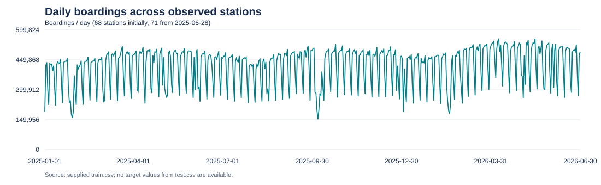
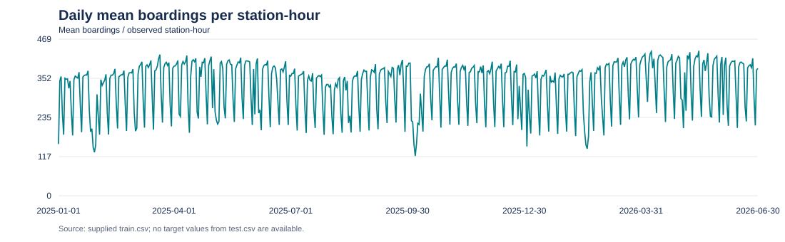
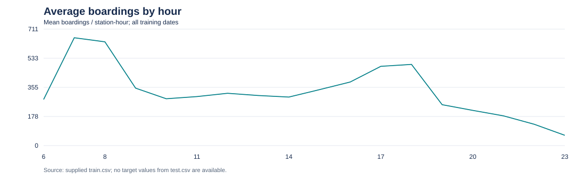

# SINCON 2026 데이터 EDA

이 보고서는 제공된 CSV의 실제 값에서 재현한 관찰 결과다. 사용자가 제공한 [공식 Overview·Data·Rules 사본](sources/rules_user_provided.txt)에 따라 과제는 **인천 지하철 71개 역의 시간대별 승차 인원(boardings)을 2026-06-30 기준으로 7~10월 123일간 한 번에 예측하는 패널 시계열 회귀**다. 공식 지표는 **RMSLE**, 제출 행 수는 **157,194행**이다. `alightings`는 학습 데이터에만 있는 하차 인원 보조 변수다.

## 1. 파일과 예측 범위

| 파일 | 행 | 열 | 셀 결측 |
| --- | --- | --- | --- |
| train.csv | 688176 | 5 | 0 |
| test.csv | 157194 | 4 | 0 |
| metaData.csv | 71 | 5 | 0 |
| sample_submission.csv | 117576 | 2 | 0 |

- 학습: **2025-01-01~2026-06-30, 546일**.
- 테스트: **2026-07-01~2026-10-31, 123일**, 71역 × 18시간 × 123일.
- 제출 예시: 테스트 앞 **92일(2026-07-01~09-30)**의 ID 117,576개와 순서까지 일치한다.
- 테스트에는 **10월 39,618행**이 추가로 있다. sample ID의 test 외 항목은 없고, 모든 ID와 (date, station_id, hour) 키는 고유하다.
- **공식 규정은 157,194행을 요구하므로 전체 test의 123일을 예측한다.** 로컬 sample의 117,576행은 구버전/불일치로 기록하고, 최종 제출의 행 수는 공식 규정과 test ID를 기준으로 검수한다. 원본 sample은 수정하지 않는다.
- `sample_submission.boardings`의 0은 양식 placeholder이며 실제 테스트 타겟이 아니다.

## 2. 규칙성·결측·역별 관측 기간

- 71개 역, 매일 **06~23시 18개 슬롯**이 제공된다. 각 역의 최초~최종 관측일 내부에는 누락 행이 **0개**, 중복 키도 0개다.
- timestamp 차이는 **1시간**(같은 날) 또는 **7시간**(23시→다음 날 06시)뿐이다. 00~05시가 파일에 없다는 뜻이며 실제 운휴를 확인한 것은 아니다. 그 시간에 0을 채워 24시간 자료로 바꾸지 않는다.
- 전체 71역 × 546일 × 18시간 격자에서 빈 9,612행은 3개 역의 첫 관측일 이전 구간이다. 이 값들은 결측 승객 수 또는 0명으로 취급하지 않는다.
- 68개 역은 2025-01-01, 3개 역(검단호수공원·신검단중앙·아라)은 **2025-06-28**부터 관측된다. 테스트에는 완전히 새로운 station_id가 없다.
- 메타데이터 `first_date`, `last_date`는 실제 관측 범위와 일치한다. 특히 `last_date=2026-06-30`은 데이터 종료일이지 폐역일이 아니다.
- 노선별 역 수: {"1": 33, "2": 27, "7": 11}. 같은 역명이라도 다른 station_id를 자동 합치지 않는다.

## 3. 타겟 분포와 급등

| 통계 | 값 |
| --- | --- |
| 평균 | 331.98 |
| 중앙값 | 240.00 |
| 표준편차 | 333.81 |
| 최솟값 | 0.0000 |
| 최댓값 | 10,189.00 |
| 왜도 | 2.9649 |
| 0인 행 수 | 76.00 |
| 0 비율 | 0.0001 |

우측 꼬리가 길다. 99% 분위수는 1,755, 99.9% 분위수는 2,496.83다. 음수는 없다. 공식 RMSLE에 맞춰 **log1p(boardings)의 MSE**를 기본 학습 손실로 사용한다. 예측은 expm1로 복원한 뒤 음수를 0으로 자른다. 원단위 MAE·RMSE·편향도 진단용으로 병행한다. 양수 카운트라는 사실만으로 Poisson 분포를 가정하지 않는다.

최대 관측값:

| date | station_id | hour | boardings | alightings | station_name | canonical_line |
| --- | --- | --- | --- | --- | --- | --- |
| 2025-11-01 | 3127 | 21 | 10189 | 79 | 문학경기장 | 1 |
| 2026-04-11 | 3127 | 22 | 8850 | 80 | 문학경기장 | 1 |
| 2026-04-05 | 3127 | 22 | 7656 | 46 | 문학경기장 | 1 |
| 2025-09-27 | 3127 | 21 | 7544 | 80 | 문학경기장 | 1 |
| 2026-04-04 | 3127 | 22 | 7307 | 58 | 문학경기장 | 1 |
| 2025-05-01 | 3127 | 21 | 7084 | 146 | 문학경기장 | 1 |
| 2025-10-11 | 3127 | 17 | 6797 | 104 | 문학경기장 | 1 |
| 2025-03-23 | 3127 | 17 | 6705 | 64 | 문학경기장 | 1 |
| 2025-03-20 | 3127 | 22 | 6549 | 72 | 문학경기장 | 1 |
| 2025-03-22 | 3127 | 17 | 6518 | 140 | 문학경기장 | 1 |
| 2025-10-31 | 3127 | 21 | 6308 | 86 | 문학경기장 | 1 |
| 2025-03-21 | 3127 | 22 | 6288 | 156 | 문학경기장 | 1 |

동일 역·시간·요일의 과거 4~8주 중앙값 대비 3배 초과이면서 승차 1,000명 이상인 휴리스틱 급등 후보는 **392행**이다. 이벤트·오류·수송 변화 여부는 원자료 설명 없이는 확정할 수 없다. 무조건 삭제하거나 상한을 자르지 않는다. 상세 목록은 `spike_candidates.csv`에 있다.

| date | station_id | hour | boardings | past_8_same_weekday_median | ratio | station_name |
| --- | --- | --- | --- | --- | --- | --- |
| 2025-03-20 | 3127 | 23 | 4057 | 4.0000 | 1,014.25 | 문학경기장 |
| 2025-03-20 | 3127 | 22 | 6549 | 7.5000 | 873.20 | 문학경기장 |
| 2026-04-05 | 3127 | 22 | 7656 | 10.00 | 765.60 | 문학경기장 |
| 2025-03-21 | 3127 | 23 | 4223 | 7.5000 | 563.07 | 문학경기장 |
| 2025-03-21 | 3127 | 22 | 6288 | 11.50 | 546.78 | 문학경기장 |
| 2026-04-04 | 3127 | 22 | 7307 | 14.00 | 521.93 | 문학경기장 |
| 2026-04-11 | 3127 | 22 | 8850 | 18.00 | 491.67 | 문학경기장 |
| 2025-03-25 | 3127 | 22 | 3838 | 9.5000 | 404.00 | 문학경기장 |
| 2025-10-01 | 3127 | 23 | 4304 | 11.50 | 374.26 | 문학경기장 |
| 2025-09-05 | 3127 | 22 | 4245 | 13.50 | 314.44 | 문학경기장 |

## 4. 달력 패턴과 시점 변화

요일 0=월요일, 6=일요일이다. 다음 수치는 역·시간당 평균이며 총량과 구별한다.

| weekday | mean | median | size |
| --- | --- | --- | --- |
| 0 | 354.40 | 255.00 | 98334 |
| 1 | 364.86 | 261.00 | 98334 |
| 2 | 369.54 | 265.00 | 98280 |
| 3 | 370.07 | 269.50 | 98280 |
| 4 | 380.71 | 283.00 | 98280 |
| 5 | 277.67 | 216.00 | 98334 |
| 6 | 206.70 | 158.00 | 98334 |

월별 표는 그 달에 관측된 행의 평균이다. 3개 역 추가에 따른 구성 변화와 달력 효과를 함께 고려해야 한다.

| month | rows | mean | total |
| --- | --- | --- | --- |
| 2025-01 | 37944 | 286.32 | 10864176 |
| 2025-02 | 34272 | 321.51 | 11018874 |
| 2025-03 | 37944 | 337.57 | 12808787 |
| 2025-04 | 36720 | 355.89 | 13068357 |
| 2025-05 | 37944 | 340.22 | 12909275 |
| 2025-06 | 36882 | 331.26 | 12217466 |
| 2025-07 | 39618 | 321.94 | 12754729 |
| 2025-08 | 39618 | 304.50 | 12063820 |
| 2025-09 | 38340 | 343.55 | 13171653 |
| 2025-10 | 39618 | 312.00 | 12360854 |
| 2025-11 | 38340 | 336.91 | 12917065 |
| 2025-12 | 39618 | 337.25 | 13361207 |
| 2026-01 | 39618 | 312.09 | 12364323 |
| 2026-02 | 35784 | 306.62 | 10972093 |
| 2026-03 | 39618 | 351.86 | 13940173 |
| 2026-04 | 38340 | 377.74 | 14482683 |
| 2026-05 | 39618 | 346.65 | 13733735 |
| 2026-06 | 38340 | 350.92 | 13454381 |

전체 일별 승차 총량의 자기상관: {"1": 0.379371570867507, "7": 0.6984332855255857, "14": 0.6908345241025416, "28": 0.6906931222349663}. 공통 요일과 추세가 포함된 EDA 상관이며 모델 잔차 ACF가 아니다. CV 후에는 역·시간별 잔차를 날짜순으로 다시 평가한다.







## 5. 역 규모와 다개체 연결성

평균 승차가 큰 역:

| station_id | station_name | canonical_line | mean | median | max |
| --- | --- | --- | --- | --- | --- |
| 3756 | 신중동 | 7 | 818.79 | 708.00 | 3182 |
| 3758 | 상동 | 7 | 790.24 | 716.00 | 2768 |
| 3757 | 부천시청 | 7 | 765.75 | 664.00 | 2493 |
| 3116 | 작전 | 1 | 725.60 | 680.00 | 2673 |
| 3126 | 인천터미널 | 1 | 693.74 | 708.00 | 1950 |
| 3119 | 부평시장 | 1 | 658.77 | 669.00 | 1924 |
| 3134 | 테크노파크 | 1 | 586.54 | 442.00 | 2364 |
| 3125 | 예술회관 | 1 | 578.83 | 521.00 | 2783 |
| 3211 | 가정(루원시티) | 2 | 569.50 | 420.00 | 2718 |
| 3762 | 산곡 | 7 | 540.91 | 401.50 | 2917 |

제공 메타데이터에는 노선은 있으나 좌표·역 간 거리·연결 목록이 없다. ID의 숫자 차이로 거리나 인접 관계를 만들지 않는다. 같은 노선 구분과 역별 이력만 즉시 사용할 수 있다.

일별 총량의 역 간 상관 상위쌍(최소 동시 관측 100일):

| station_a | station_b | name_a | name_b | same_canonical_line | raw_daily_correlation | weekday_demeaned_correlation |
| --- | --- | --- | --- | --- | --- | --- |
| 3756 | 3761 | 신중동 | 부평구청 | True | 0.9957 | 0.9891 |
| 3211 | 3762 | 가정(루원시티) | 산곡 | False | 0.9954 | 0.9887 |
| 3117 | 3762 | 갈산 | 산곡 | False | 0.9952 | 0.9847 |
| 3132 | 3211 | 동막 | 가정(루원시티) | False | 0.9952 | 0.9861 |
| 3756 | 3760 | 신중동 | 굴포천 | True | 0.9949 | 0.9865 |
| 3132 | 3762 | 동막 | 산곡 | False | 0.9942 | 0.9827 |
| 3215 | 3762 | 인천가좌 | 산곡 | False | 0.9942 | 0.9827 |
| 3761 | 3762 | 부평구청 | 산곡 | True | 0.9941 | 0.9869 |
| 3129 | 3215 | 신연수 | 인천가좌 | False | 0.9939 | 0.9805 |
| 3113 | 3123 | 임학 | 간석오거리 | True | 0.9934 | 0.9832 |

- 전체 2,485개 역 쌍의 원자료 상관 중앙값: 0.9291.
- 각 역의 요일 평균을 제거한 상관 중앙값: 0.8641.
- 상위 10쌍의 ±3일 지연 상관은 `eda.json`에 기록했다. 이는 날짜 단위의 동조 점검이다. 1시간보다 짧은 열차 이동/승객 전파를 검증하지 못하며 인과적 연결 또는 물리적 전파 지연의 근거가 아니다.
- 전체 학습 구간으로 만든 상관은 EDA 전용이다. 모델의 그룹/이웃 특징으로 쓰려면 각 CV origin 이전 이력에서만 다시 계산한다.

## 6. 입력 가용성과 누수 방지

| 구분 | 변수/처리 |
| --- | --- |
| 미래에도 주어짐 | date, station_id, hour, canonical_line |
| 파일에서 직접 파생 가능 | 요일·주말·월·연중일·시간 및 달력 주기 sin/cos |
| 학습에만 있음 | boardings, alightings |
| 없음 | 날씨, 공휴일 라벨, 할인·행사, 운행 장애, 좌표, 물리적 인접 정보 |
| 규정상 허용된 외부 입력 | 2026-06-30 이전 공개되고 비상업 이용이 허용된 공휴일·일정 등. 출처·조회일·라이선스 기록 필요 |

공휴일은 `src/holiday_calendar.py`의 검증된 정적 달력에서 생성한다. 공식 출처와 공개시점은 [holiday_sources.md](holiday_sources.md)에 기록했다. 원본 CSV에는 공휴일이 없으며 외부 특징으로 추가한 것이다. 임시공휴일과 신규 지정일은 각 CV 예측 기준일에 알려진 정보만 활성화한다. 2026-05-01 노동절과 2026-07-17 제헌절을 포함하고, 2026-09-28은 공휴일로 표시하지 않는다.

같은 행의 승차·하차 상관은 0.5632다. **미래 alightings는 test에 없으므로 동시점 하차 값을 입력하면 누수/추론 불일치다.** origin 이전의 요약·지연 하차만 쓸 수 있다. 123일 전체를 한 번에 예측할 때 day 8의 실제 lag7처럼 origin 이후 관측을 참조해서는 안 된다. 직접 다중 horizon 특징이나 origin에 고정한 계절/이동 통계가 필요하다.

## 7. 재현 및 보존

```bash
python src/eda.py --data-dir data/raw --out-dir reports
```

이 스크립트는 원본을 수정하지 않는다. `eda.json`에 입력 SHA-256, 자료형, 정확한 수치와 정의가 있고, 보조 CSV에 역별 범위·분포·상관·급등 후보가 있다. 그림은 집계값을 그대로 사용한다. 파일 크기는 약 24 MB이므로 이 단계의 원본만으로 29 GB RAM이 부족하지 않다. 다중 origin × horizon × 파생변수를 확장하면 메모리가 증가하므로 float32·정수 다운캐스팅, origin 배치 생성, 메모리 사용량 계측이 필요하다.
