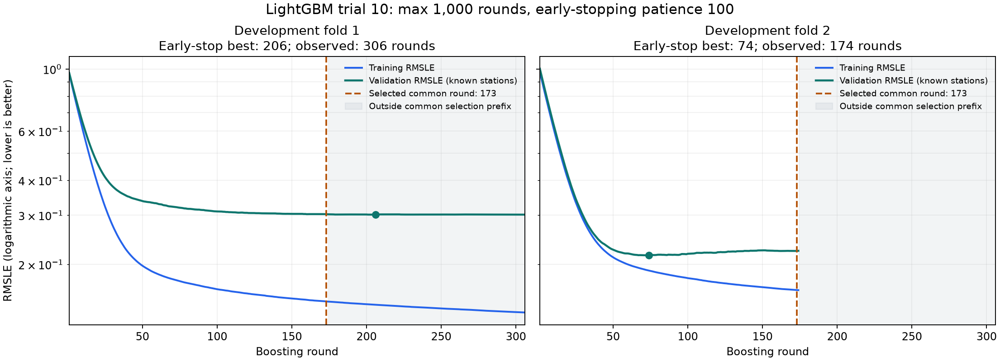

# LightGBM 재학습·early stopping·설정 탐색 결과

작성 기준: 2026-11-11. 이 문서는 실제 완료된 `outputs/lightgbm_tuned` 산출물을 읽어 생성했다.

## 결과

- 사용자 요청대로 **최대 1,000 부스팅 라운드**, **early-stopping patience 100회**, **최소 개선폭 1e-05**를 적용했다.
- 개발 구간에서 **16개 설정**을 비교한 결과, 후보 **10번**, 공통 반복 수 **173회**가 선정됐다.
- 개발의 기존 역 행을 합산한 RMSLE는 **0.265038335**다. 개발 점수는 설정 선택에 사용한 값이다.
- 2026-02-28~06-30의 123일·157,194행에서 기존 LightGBM **0.253972532 → 재학습 LightGBM 0.247808329**, 상대 2.43% 감소.
- 이전 3모델 앙상블의 동일 구간 RMSLE는 **0.258433409**다.
- 최종 저장 모델은 **LightGBM 단독 100%**이며 실제 트리는 **173개**다. 계절 모델·XGBoost·CatBoost 가중치를 새로 적합하지 않았다.
- 전체 탐색·재학습·진단·제출 생성에 **247.7초**가 걸렸다. 패키지 설치와 이 보고서 생성 시간은 제외한다.
- Kaggle에 제출하지 않았다. 이 점수는 리더보드 점수가 아니다.

이번 설정은 기존 LightGBM보다 이 비교 구간의 RMSLE가 낮았다. 다만 이미 분석한 구간이므로 새로운 독립 검증 성능으로 보지 않는다.

## 1. Optimizer와 전역 최적점의 의미

**LightGBM은 AdamW를 사용하지 않는다.** 로그 타겟의 gradient/Hessian을 이용해 트리 분할과 리프 출력을 순차적으로 적합하는 GBDT다.
프로젝트의 `torch.optim.AdamW`는 이전 MLP 구현에만 사용한다. 이번 학습에는 MLP가 포함되지 않는다.
사용자의 1,000 epoch 요청은 이 회귀 GBDT에서 **1,000 boosting rounds를 상한으로 설정**하는 것으로 적용했다.

이번 탐색은 가능한 모든 트리 구조·하이퍼파라미터 조합의 전역 최적해를 증명하지 않는다.
정확한 결론은 **미리 고정한 16개 후보와 각 후보의 두 개발 fold가 공통으로 관측한 반복 범위에서 최선**이라는 것이다.
Early stopping은 각 후보를 항상 1,000회까지 돌리지 않으므로 모든 후보의 1~1,000회 전체를 비교했다고 말할 수 없다.
이번 실행에서 개발 모델 32개 중 1,000회 상한까지 관측한 경우는 **1개**다.

## 2. 기존 가중치 별도 보관

원래 220회 LightGBM은 재학습 전에 아래 경로로 별도 보관했다.

`archives/lightgbm_large_220_before_tuning_20261111_194707`

- [원래 LightGBM 단독 객체](../archives/lightgbm_large_220_before_tuning_20261111_194707/lightgbm_large.joblib)
- [원래 LightGBM 텍스트 모델](../archives/lightgbm_large_220_before_tuning_20261111_194707/lightgbm_large.txt)
- [원래 전체 모델 bundle](../archives/lightgbm_large_220_before_tuning_20261111_194707/model_bundle.joblib)
- [원래 LightGBM 제출 파일](../archives/lightgbm_large_220_before_tuning_20261111_194707/submission_primary.csv)
- [백업 파일 SHA-256 목록](../archives/lightgbm_large_220_before_tuning_20261111_194707/manifest.json)

이 보고서 생성 시 백업 목록 9개 파일의 해시를 모두 대조했고, 기존 `outputs/three_tree/model_bundle.joblib`도 백업과 동일함을 확인했다.
새 모델은 별도 `outputs/lightgbm_tuned`에 저장했다.

## 3. 시간 순서와 검증 대상

입력 특징 60개와 학습 행 생성 방식은 유지했다. 각 예측 기준일 이전 관측으로 특징을 만들며,
학습 타겟의 전체 123일 구간은 해당 기준일까지 종료되도록 제한했다.
개발 탐색에 전달한 관측은 **2026-02-27까지**이며 그 뒤의 마지막 비교 구간 타겟을 early stopping에 사용하지 않았다.

실제 테스트에는 관측 이력이 전혀 없는 역이 없으므로, 개발 지표도 **해당 기준일까지 관측된 역**에서 계산했다.
개발 1의 신규 역 **6,588행**은 선택 지표에서 제외하되, 전체 역 점수는 별도 진단으로 남겼다.
이 선택은 앞선 분석 이후 정한 검증 설계이므로, 마지막 구간을 새로운 독립 holdout으로 해석하면 안 된다.

| 개발 fold | 예측 기준일 | 선택 행 | 제외 신규 역 행 | pooled 지표 행 가중치 | 기존 220회 RMSLE | 재학습 RMSLE |
| --- | --- | --- | --- | --- | --- | --- |
| 1 | 2025-06-26 | 150,552 | 6,588 | 48.921% | 0.309142614 | 0.302387178 |
| 2 | 2025-10-27 | 157,194 | 0 | 51.079% | 0.224127678 | 0.223490713 |


여기서 행 가중치는 **CV 손실 합산에 쓰는 비중**이다. 여러 모델의 앙상블 가중치를 뜻하지 않는다.
평균 RMSLE를 단순 평균하지 않고 각 fold RMSLE를 제곱한 뒤 행 수로 가중 평균하고 제곱근을 취한다.

전체 역 결과는 다음과 같으며, 개발 1의 전체 역 점수에는 선택 지표에서 제외한 신규 역이 포함돼 위 표와 다르다.

| fold | 평가 범위 | 기존 LightGBM RMSLE | 재학습 LightGBM RMSLE |
| --- | --- | --- | --- |
| 1 | 전체 역 사후 진단 | 0.657957785 | 0.607164592 |
| 2 | 전체 역 사후 진단 | 0.224127678 | 0.223490713 |
| 3 | 재사용 마지막 비교 구간 | 0.253972532 | 0.247808329 |


## 4. Early stopping과 공통 반복 수 선택

LightGBM 기본 회귀 지표를 `metric='None'`으로 끄고, 다음 평가 함수를 사용했다.

```python
# y_log = log1p(boardings), pred_log = 모델의 로그 공간 출력
rmsle = sqrt(mean((maximum(pred_log, 0) - y_log) ** 2))
```

이는 추론 시 음수 로그 출력을 0으로 자른 뒤 `expm1`으로 복원하는 실제 제출 예측과 일치한다.
Training과 validation 곡선을 모두 기록하고, validation RMSLE가 1e-05 이상 개선되지 않는 상태가
100회 연속 이어지면 해당 개발 학습을 종료했다. Training 지표는 종료 기준에 사용하지 않았다.

선정 후보의 개발별 종료 기록:

| 개발 fold | 개별 best iteration | 관측한 반복 수 | early-stop 모델에 남은 트리 | 개별 best 검증 RMSLE | 1,000회 이전 종료 | 개별 best 학습 RMSLE |
| --- | --- | --- | --- | --- | --- | --- |
| 1 | 206 | 306 | 206 | 0.301371240 | 예 | 0.143368807 |
| 2 | 74 | 174 | 74 | 0.215254200 | 예 | 0.190004276 |


서로 다른 fold의 개별 best iteration을 단순 평균하거나 중앙값으로 정하지 않았다.
선정 후보에서는 두 학습 곡선이 공통으로 존재하는 **1~174회**에서
행 수 가중 RMSLE가 최소인 **173회**를 최종 반복 수로 정했다.
같은 반복 수의 예측을 비교하므로 관측하지 않은 구간을 추정하거나, 중단 이후 곡선을 임의로 연장하지 않는다.



점선은 최종 공통 반복 수, 녹색 점은 각 fold의 early-stopping best iteration이다.
회색 영역은 두 fold의 공통 비교 범위를 벗어난 반복 구간이다. 세로축은 RMSLE의 로그 눈금이며,
선택 알고리즘에는 원래 RMSLE 수치를 사용했다. 곡선 원자료는 후보별 CSV에 보관했다.

최종 전체 데이터에는 개발에서 선정한 설정과 반복 수를 적용해 다시 학습했다.
**최종 전체 데이터 모델 자체에는 별도 검증을 다시 붙여 early stopping을 하지 않는다.**
종료점이 개발에서 이미 고정됐기 때문이다. 2026년 7~10월 실제 정답은 사용하지 않았다.

## 5. 선정된 학습·규제 설정

| 파라미터 | 기존 Large | 이번 선정 설정 |
| --- | --- | --- |
| n_estimators | 220 | 173 |
| learning_rate | 0.055 | 0.055 |
| num_leaves | 63 | 127 |
| max_depth | -1 | -1 |
| min_child_samples | 80 | 80 |
| reg_lambda | 3 | 10 |
| reg_alpha | 0 | 0.1 |
| colsample_bytree | 0.9 | 0.9 |
| subsample | 0.9 | 0.75 |
| subsample_freq | 1 | 1 |
| min_split_gain | 0 | 0 |


공통으로 `objective='regression'`, 타겟 `log1p(boardings)`, 시드 2026, CPU 4스레드,
`linear_tree=False`를 유지한다. `station_id`, `canonical_line`, `hour`, `dow`를 범주형으로 처리한다.
`n_estimators`의 이번 값은 최종 재학습에 쓰는 선정 반복 수이며 탐색 상한 1,000회와 구별한다.
최종 학습 사례는 **220,000행**, 특징은 **60개**다.

리프 수·최소 리프 표본·깊이 상한·L1/L2 규제·행/특징 샘플링을 후보 설정에서 달리했다.
규제와 조기 종료를 사용했다는 사실만으로 과적합이 완전히 제거됐다고 단정하지 않는다.
개발 지표에 여러 후보를 비교한 선택 편향과 계절·역별 분포 변화는 남아 있다.

## 6. 전체 후보 기록

아래 표는 모든 후보의 공통 관측 구간 내 최선 반복 수와 개발 점수다.
표의 일부 설정 외 나머지 규제값은 [전체 search_results.csv](../outputs/lightgbm_tuned/search_results.csv)와
각 후보의 `trial.json`에 기록돼 있다.

| 후보 | 학습률 | 리프 | 최소 표본 | L2 | 공통 선정 반복 | 공통 관측 상한 | 개발 RMSLE | 학습 곡선 CSV |
| --- | --- | --- | --- | --- | --- | --- | --- | --- |
| 1 | 0.055 | 63 | 80 | 3 | 178 | 181 | 0.268083406 | [개발 1](../outputs/lightgbm_tuned/search/trial_01/fold_1_learning_curve.csv) · [개발 2](../outputs/lightgbm_tuned/search/trial_01/fold_2_learning_curve.csv) |
| 2 | 0.03 | 63 | 160 | 10 | 162 | 254 | 0.273192396 | [개발 1](../outputs/lightgbm_tuned/search/trial_02/fold_1_learning_curve.csv) · [개발 2](../outputs/lightgbm_tuned/search/trial_02/fold_2_learning_curve.csv) |
| 3 | 0.08 | 31 | 160 | 10 | 140 | 150 | 0.274248644 | [개발 1](../outputs/lightgbm_tuned/search/trial_03/fold_1_learning_curve.csv) · [개발 2](../outputs/lightgbm_tuned/search/trial_03/fold_2_learning_curve.csv) |
| 4 | 0.03 | 127 | 160 | 10 | 177 | 249 | 0.269593919 | [개발 1](../outputs/lightgbm_tuned/search/trial_04/fold_1_learning_curve.csv) · [개발 2](../outputs/lightgbm_tuned/search/trial_04/fold_2_learning_curve.csv) |
| 5 | 0.08 | 31 | 80 | 10 | 86 | 156 | 0.273165403 | [개발 1](../outputs/lightgbm_tuned/search/trial_05/fold_1_learning_curve.csv) · [개발 2](../outputs/lightgbm_tuned/search/trial_05/fold_2_learning_curve.csv) |
| 6 | 0.04 | 127 | 320 | 30 | 133 | 219 | 0.265505150 | [개발 1](../outputs/lightgbm_tuned/search/trial_06/fold_1_learning_curve.csv) · [개발 2](../outputs/lightgbm_tuned/search/trial_06/fold_2_learning_curve.csv) |
| 7 | 0.025 | 63 | 80 | 30 | 228 | 277 | 0.269869060 | [개발 1](../outputs/lightgbm_tuned/search/trial_07/fold_1_learning_curve.csv) · [개발 2](../outputs/lightgbm_tuned/search/trial_07/fold_2_learning_curve.csv) |
| 8 | 0.08 | 31 | 160 | 10 | 64 | 156 | 0.274902160 | [개발 1](../outputs/lightgbm_tuned/search/trial_08/fold_1_learning_curve.csv) · [개발 2](../outputs/lightgbm_tuned/search/trial_08/fold_2_learning_curve.csv) |
| 9 | 0.025 | 63 | 80 | 3 | 249 | 274 | 0.271909101 | [개발 1](../outputs/lightgbm_tuned/search/trial_09/fold_1_learning_curve.csv) · [개발 2](../outputs/lightgbm_tuned/search/trial_09/fold_2_learning_curve.csv) |
| 10 **선정** | 0.055 | 127 | 80 | 10 | 173 | 174 | 0.265038334 | [개발 1](../outputs/lightgbm_tuned/search/trial_10/fold_1_learning_curve.csv) · [개발 2](../outputs/lightgbm_tuned/search/trial_10/fold_2_learning_curve.csv) |
| 11 | 0.04 | 95 | 80 | 10 | 200 | 207 | 0.266378164 | [개발 1](../outputs/lightgbm_tuned/search/trial_11/fold_1_learning_curve.csv) · [개발 2](../outputs/lightgbm_tuned/search/trial_11/fold_2_learning_curve.csv) |
| 12 | 0.08 | 127 | 320 | 10 | 59 | 155 | 0.268414988 | [개발 1](../outputs/lightgbm_tuned/search/trial_12/fold_1_learning_curve.csv) · [개발 2](../outputs/lightgbm_tuned/search/trial_12/fold_2_learning_curve.csv) |
| 13 | 0.08 | 95 | 160 | 10 | 68 | 162 | 0.268457016 | [개발 1](../outputs/lightgbm_tuned/search/trial_13/fold_1_learning_curve.csv) · [개발 2](../outputs/lightgbm_tuned/search/trial_13/fold_2_learning_curve.csv) |
| 14 | 0.055 | 63 | 80 | 3 | 162 | 178 | 0.271293436 | [개발 1](../outputs/lightgbm_tuned/search/trial_14/fold_1_learning_curve.csv) · [개발 2](../outputs/lightgbm_tuned/search/trial_14/fold_2_learning_curve.csv) |
| 15 | 0.055 | 63 | 160 | 10 | 110 | 179 | 0.269409536 | [개발 1](../outputs/lightgbm_tuned/search/trial_15/fold_1_learning_curve.csv) · [개발 2](../outputs/lightgbm_tuned/search/trial_15/fold_2_learning_curve.csv) |
| 16 | 0.055 | 63 | 160 | 3 | 95 | 170 | 0.274343443 | [개발 1](../outputs/lightgbm_tuned/search/trial_16/fold_1_learning_curve.csv) · [개발 2](../outputs/lightgbm_tuned/search/trial_16/fold_2_learning_curve.csv) |


## 7. 저장·재현·제출 검수

- 개발에서 선정한 점수: **0.265038334330**.
- 같은 설정·고정 반복으로 재학습한 개발 점수: **0.265038335207**.
- Early stopping 모델의 저장 트리 수가 공통 선정 반복보다 적을 수 있으므로, 선정 설정을 고정 반복으로 다시 학습해 점수 일치를 확인했다.
- 최종 저장 모델의 재로딩 예측과 원래 예측이 일치했고, 생성 CSV의 SHA-256도 일치했다.
- 실제 최종 트리 **173개 ≤ 1,000회**를 확인했다.
- 제출 파일은 **157,194행**, 전체 test ID와 순서, 결측·무한대·음수 검사를 통과했다.
- 원본 sample의 92일 범위 대신 공식 123일 test 전체를 사용한다.
- 최종 제출 SHA-256: `b194efc10ba25bd362c3eddff6a0123354e6baa27f3f1e58e9faf7b1b403e5e4`.

산출물:

- [재학습 제출 CSV](../outputs/lightgbm_tuned/submission.csv)
- [재학습 모델 bundle](../outputs/lightgbm_tuned/model_bundle.joblib)
- [LightGBM 텍스트 모델](../outputs/lightgbm_tuned/lightgbm_tuned.txt)
- [실제 적용 설정](../outputs/lightgbm_tuned/config_resolved.json)
- [탐색 설계와 동결된 선정 결과](../outputs/lightgbm_tuned/selected_plan.json)
- [검증·재현 결과](../outputs/lightgbm_tuned/verification.json)
- [기존 LightGBM 학습 설정 점검](../analysis/lightgbm/TRAINING_AUDIT.md)

```bash
cd /Users/hongtaeyang/Desktop/SINCON
# 기존 완료 결과를 덮어쓰지 않도록 새 출력 폴더 지정
.venv/bin/python -m src.tune_lightgbm --config configs/three_tree.json --max-rounds 1000 --patience 100 --trials 16 --output outputs/lightgbm_tuned_repeat
# 현재 저장 모델만 다시 추론
.venv/bin/python -m src.pipeline infer --model outputs/lightgbm_tuned/model_bundle.joblib --output outputs/lightgbm_tuned_cli_reload
# 현재 완료 결과에서 이 보고서와 그림 재생성
.venv/bin/python scripts/build_lightgbm_tuning_report.py
```
