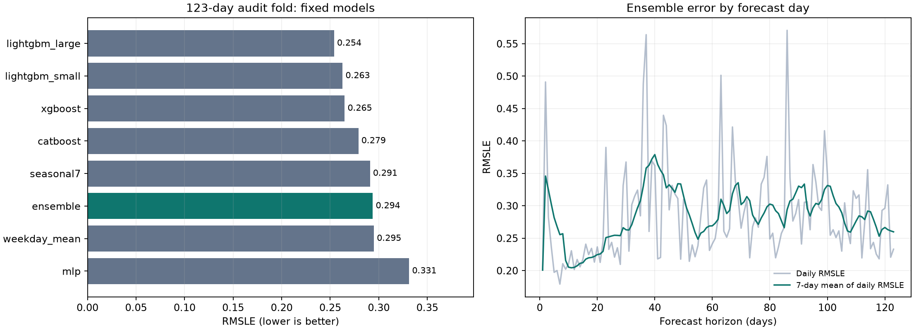
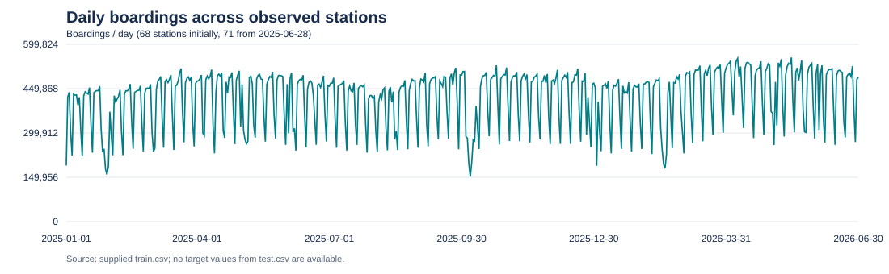

# SINCON 2026 · 과제 분석과 10단계 실행 보고서

> 이 문서는 이전 실험 기록입니다. 현재 모델과 점수는 [LightGBM 재학습 보고서](LIGHTGBM_TUNING.md)를 참고하세요.

작성·실행 기준일: **2026-11-11, 한국 시간**. 작업 폴더: `/Users/hongtaeyang/Desktop/SINCON`.

> **이 문서는 초기 7모델 실험 기록입니다. 현재 활성 파이프라인과 새 점수는 [3모델 재앙상블 보고서](THREE_TREE_REENSEMBLE.md)를 참고하세요.**

## 실행 결과 먼저 보기

- 과제: 2026-06-30을 기준으로 인천 지하철 71역 × 18시간 × 123일의 승차 인원 **157,194개를 한 번에 예측**.
- 공식 지표: **RMSLE**. 모든 학습 모델은 `log1p(boardings)`의 제곱오차를 최소화한다.
- EDA, 60개 특징, 시간순 3개 fold, 7개 모델 설정 비교, 개발 OOF 앙상블, 최종 재학습·CSV·검수까지 실행했다.
- 마지막 123일 감사 구간 RMSLE **0.293853**. 계절 복사 대비 0.98% 증가. 해당 값은 Kaggle 점수가 아니다.
- 감사 구간에서 가장 낮은 단일 모델은 `lightgbm_large`의 **0.253973**다. 앙상블이 모든 구간에서 단일 모델을 이겼다는 결론은 내리지 않는다. 이 감사 결과로 가중치를 다시 맞추지 않았다.
- 학습·진단·최종 생성 실행 73.4초, 프로세스 peak RSS 약 2.57GiB. 의존성 설치·최초 환경 초기화·EDA 시간은 제외한다. macOS ARM CPU 측정값이며 Kaggle T4 성능을 측정한 값은 아니다.
- 최종 파일: [submission.csv](../outputs/baseline/submission.csv). 추가 비교용: [submission_best_single.csv](../outputs/baseline/submission_best_single.csv), 개발 OOF로 고른 단일 모델.
- 원본 sample은 117,576행뿐이다. 공식 설명과 `test.csv`를 우선해 **10월 39,618행까지 포함**했다.



## 1단계. 과제·평가지표·규정 설정

### 과제와 손실함수

`date, station_id, hour → boardings`의 비음수 패널 시계열 회귀다. 06시는 06~07시, 23시는 23~24시를 뜻한다. 테스트 기간 도중 정답을 받아 갱신하는 온라인 예측이 아니다. 한 origin에서 123일 전체를 직접 예측한다.

공식 산식은 다음과 같다.

$$\mathrm{RMSLE}=\sqrt{\frac{1}{n}\sum_i\left[\log(1+\hat y_i)-\log(1+y_i)\right]^2}.$$

`z=log1p(y)`에 MSE/L2를 학습하면 RMSLE와 최적점이 같다. LightGBM `regression`, XGBoost `reg:squarederror`, CatBoost `RMSE`, PyTorch `MSELoss`를 사용한다. 예측 로그값을 `expm1`으로 한 번 복원하고 음수를 0으로 자른다. SMAPE·MAE용 중앙값 전략, 원단위 MBE 상수 보정, 로그정규 분산 보정을 자동 추가하지 않는다.

### 공식 규정

사용자가 제공한 Overview·Data·Rules를 근거로 확정했다. 직접 웹 페이지는 처음에 접근하지 못했지만 이후 제공된 본문을 반영했다. 세부 근거와 원문은 [official_sources.md](official_sources.md), [Rules 원문](sources/rules_user_provided.txt)에 있다.

| 항목 | 적용 규칙 |
|---|---|
| 제출 | `example_id,boardings`, 정확히 157,194행, 중복 없음, 비음수·유한값, 소수 허용 |
| 제출 횟수 | 팀 전체 하루 10회, 한국 시간 09:00 초기화, 최종 2개 선택 |
| 마감 | 2026-11-13 21:00 KST |
| 평가 분할 | 월마다 날짜 단위 절반. Public 61일·77,958행, Private 62일·79,236행 |
| 외부 자료·모델 | 2026-06-30 이전 공개되고 예측 시점에 알 수 있던 것만, 출처·조회일·이용 조건 기록 |
| 금지 정보 | 2026년 7월 이후 실제 지하철 실적, 날씨 실측, 경기 개최 결과, 사후 뉴스·통계, 비공개 정답 |
| 실행 환경 | 자유. 최종 코드는 Kaggle Notebook 또는 Colab에서 실행 가능한 규모 |
| 대회 실행 시간 제한 | 별도로 없음. 일반 Kaggle 세션 제한과 구별 |

일반 Kaggle 문서의 CPU/GPU 12시간·TPU 9시간·T4x2 시스템 RAM 29GB 등은 플랫폼 참고치다. 주간 30 GPU시간을 현재 계정의 고정 잔여 한도로 단정하지 않았다. 이번 결과는 GPU를 사용하지 않았다. 외부 사전학습 가중치도 사용하지 않았다.

## 2단계. 데이터 구조와 EDA

| 파일 | 행 × 열 | 기간·의미 |
|---|---:|---|
| train.csv | 688,176 × 5 | 2025-01-01~2026-06-30, 546일 |
| test.csv | 157,194 × 4 | 2026-07-01~10-31, 123일 |
| metaData.csv | 71 × 5 | 역 ID·이름·노선·관측 범위 |
| sample_submission.csv | 117,576 × 2 | 테스트 7~9월에만 대응하는 구버전 불일치 |

셀 결측·중복 키·각 역의 실제 관측 기간 내부 누락 행은 모두 0이다. 시간 간격은 같은 날 1시간, 23시에서 다음 날 06시로 넘어갈 때 7시간이다. 00~05시를 임의로 0으로 보간하지 않는다. 세 역 3107·3108·3109는 2025-06-28부터 관측된다. 이전 9,612개 격자는 0명 관측이 아니다. `first_date/last_date`는 공식 개통일·폐역일이 아니며 역 이름이 같아도 다른 ID를 합치지 않는다.

승차 평균 331.98, 중앙값 240, 최댓값 10,189, 왜도 2.965다. 0은 76행, 약 0.0110%다. 주간 주기가 강하고 일별 총량의 lag7 ACF는 약 0.698이다. 문학경기장역 야간 급등이 눈에 띄지만, 관측 사실만으로 특정 경기·행사의 결과라고 단정하지 않는다.

날씨·할인·학사 일정·좌표·거리·연결 그래프는 원본에 없다. `alightings`는 과거 관측에만 있다. 역별 일간 상관은 높지만 공통 요일·추세의 영향을 받으므로 물리적 전파 지연으로 해석하지 않는다. 좌표 없는 임의 그래프를 만들지 않았다. [상세 EDA](EDA.md)에 분포·급등·상관 분석과 재현 CSV를 담았다.



### 추가한 외부 공변량

공식적으로 사전에 발표된 한국 공휴일만 정적 코드로 추가했다. 공휴일·종류·대체·임시·선거·음력명절·노동절·휴일 전후·징검다리 등 12개 달력 특징을 쓴다. 2026년 5/1·7/17 추가 공휴일과 8/17·10/5 대체공휴일을 반영했다. 2026-09-28과 06-08을 잘못 대체공휴일로 추가하지 않았다. 근거의 공개일·조회일·라이선스는 [holiday_sources.md](holiday_sources.md)에 있다.

## 3단계. Local CV와 5대 보조 지표

| 역할 | origin | 검증 기간 | 검증 행 | 학습 표본 |
|---|---|---|---:|---:|
| development 1 | 2025-06-26 | 2025-06-27~2025-10-27 | 157,140 | 220,000 |
| development 2 | 2025-10-27 | 2025-10-28~2026-02-27 | 157,194 | 219,996 |
| audit 3 | 2026-02-27 | 2026-02-28~2026-06-30 | 157,194 | 220,000 |


검증 날짜는 겹치지 않는다. 개발 fold 1·2만 모델 중복·가중치·로그 편향 선택에 쓰고, 마지막 123일을 감사용으로 남긴다. 첫 fold는 신규 3개 역의 초기 이력을 포함해 더 어려운 cold-start 스트레스 테스트다. 테스트에는 신규 ID가 없으므로 초기 fold를 동일 가중으로 섞은 것이 최종 성능에 불리할 가능성도 기록한다. GroupKFold는 알려진 역의 미래 예측이라는 본 과제와 다르므로 기본 선택에 쓰지 않았다.

학습 예제를 만들 때 28일 간격의 과거 origin과 마지막 허용 origin을 사용한다. 각 origin의 1~123일 정답 구간이 전부 현재 cutoff 안에 들어오는 경우만 학습한다. 즉 **마지막 학습 origin + 123일 ≤ 검증 origin**이다. 다만 검증 시점에 이미 관측된 최근 데이터는 검증 특징 생성에 사용할 수 있다. 학습 anchor들의 정답 창은 서로 겹칠 수 있다. 원자료 전체에 무작위 train/valid 분할을 하지 않으며, 계산량 제한용 학습 행 샘플링은 시간 분할이 끝난 학습 창 내부에서만 한다.

| 지표 | 구현·해석 |
|---|---|
| MBE | `mean(pred-y)`, 양수는 과대, 음수는 과소 예측 |
| RMSE/MAE | 급등 구간에 원단위 오차가 집중되는지 확인. 1.5는 탐색용 신호이지 보편 판정선이 아님 |
| MASE | 역×시간별 훈련 이력에서 정확히 7일 전 관측과의 절대차 평균을 분모로 사용. 각 개체 MAE/분모를 macro 및 행 가중 평균 |
| 잔차 ACF | 역×시간별 정확히 1·7·28일 차의 잔차끼리 상관. 역 경계·일자 누락을 넘어 단순 행 shift하지 않음 |
| 스텝별 오차 | 1~123일 horizon별 RMSLE·MAE·RMSE·MBE와 월별 지표 |

MASE 분모 0 또는 이력 부족, 분산이 없어 ACF가 정의되지 않는 경우에는 null/NaN과 coverage를 기록한다. 0으로 성공 처리하지 않는다. MASE>1은 훈련 구간 계절변동 규모 대비 오차가 크다는 뜻이며, 같은 검증 구간 계절 모델보다 실제로 나쁜지는 별도 기준선 점수로 확인한다. ACF |r|>0.1도 탐색 기준이며 다중검정 유의성을 뜻하지 않는다.

Public/Private가 날짜 단위로 나뉘는 규칙을 고려해 감사 날짜 블록을 500번 재표집한 RMSLE 구간도 저장했다. 95% 구간은 **0.2782~0.3096**이며 미래 리더보드 성능 보장은 아니다.

## 4단계. 모델군 선정과 베이스라인

원본은 규칙적인 시계열과 알려진 미래 달력 공변량의 결합이다. 먼저 계절 기준선과 전역 GBDT를 실행해 전체 파이프라인을 연결했다. 분류·이상탐지·불규칙 이벤트 과제용 모델은 적용하지 않았다. 거리·좌표 없는 상황에서 공간 그래프 모델을 필수로 두지 않았다.

| 모델 | 개발 1 RMSLE | 개발 2 RMSLE | 감사 RMSLE |
|---|---:|---:|---:|
| seasonal7 | 0.463067 | 0.320222 | 0.291005 |
| weekday_mean | 0.454483 | 0.311047 | 0.294989 |
| lightgbm_small | 0.632489 | 0.227001 | 0.262701 |
| lightgbm_large | 0.657958 | 0.224128 | 0.253973 |
| catboost | 0.447682 | 0.220654 | 0.279056 |
| xgboost | 0.758378 | 0.239894 | 0.264858 |
| mlp | 0.625472 | 0.526600 | 0.331299 |
| ensemble | — | — | 0.293853 |


요청에 있는 TimeH2O-v1·Timestral-209M·Chronos-2·TabM·TabPFN-TS·TimeXer·TimeMixer++·각 분류/이상탐지/공간 모델의 적용 여부는 [MODEL_DECISIONS.md](MODEL_DECISIONS.md)에 모두 정리했다. 후보의 이름만으로 실제 체크포인트·라이선스·기준일 공개 여부·성능을 확인한 것처럼 쓰지 않았다. 이 프로젝트에서 학습한 작은 MLP는 TabM이나 파운데이션 모델이 아니다.

## 5단계. 트리와 신경망 전처리

`src/features.py`는 과거 데이터를 `date<=origin`으로 먼저 자른다. query에 정답 열이 들어 있어도 특징으로 선택하지 않는다. 결과 60개 열은 float32로 저장한다.

- 날짜·월·요일·시간·주말·연중일·예측 horizon 및 sin/cos 주기.
- 역 ID·노선. CatBoost/LightGBM은 ID·노선·시간·요일을 범주형으로 처리한다. XGBoost 기준선의 ID는 정수 입력이며 물리 거리로 해석하지 않는다.
- 최근 28·56·112일 같은 역×시간×요일의 평균·중앙값·표준편차·관측 수, 과거 하차량 평균.
- origin에 고정된 1·7·28일 시차, 최근 28일 전체 요일 통계, 과거 마지막 동일 요일 복사.
- `target_date-364일`의 관측. 참조일이 origin 뒤이면 사용하지 않는 명시적 방어를 둔다.
- 과거 노선×시간×요일·전체 시간×요일 집계, 관측된 이력 길이·cold-start, 추세비·승하차비.
- 발표일이 해당 origin 이전인 공휴일만 사용. 달력의 `known_since` 값 자체는 특징에 넣지 않는다.

트리는 일괄 스케일링하지 않고 숫자 NaN을 유지한다. CatBoost의 범주형 값만 문자열로 바꾼다. MLP는 선택한 수치 특징의 훈련 중앙값 대치·훈련 평균/표준편차 정규화·결측 마스크를 사용한다. 타겟은 기준선 로그값에 대한 잔차로 학습하되 제곱오차는 여전히 로그 타겟 오차와 같다. 입력 구간 정규화·복원 모듈인 RevIN을 구현했다고 주장하지 않는다.

원본 CSV는 Polars lazy scan과 정수 축소를 거쳐 읽는다. 실제 집계는 데이터 크기에 맞춰 pandas에서 수행한다. 모든 계산이 Polars lazy라는 뜻은 아니다. fold별 학습 행은 최대 220,000개, 특징 행렬 자체는 약 52.8MB다. 123일 전체 질의도 한 번에 처리 가능한 크기다.

## 6단계. 본 학습과 실행 자원

| 모델 | 기본 설정 |
|---|---|
| LightGBM small | 150 trees, 31 leaves, lr 0.055, min_child_samples 80, L2 3 |
| LightGBM large | 220 trees, 63 leaves, 나머지 동일 |
| CatBoost | 220 iterations, depth 7, lr 0.07, L2 5, CPU threads 4 |
| XGBoost | 180 trees, depth 6, lr 0.06, min_child_weight 30, L2 5, histogram |
| MLP | 96→64 hidden units, ReLU, AdamW lr 0.001, weight decay 0.001, 10 epochs, batch 2048, 최대 160k 표본 |
| 공통 | seed 2026, 타겟 log1p, MSE/RMSE, 미래 실제 공변량 없음 |

LightGBM `linear_tree=True`는 기본으로 쓰지 않았다. 수치 스케일·메모리·외삽을 별도로 검증해야 하며 L1 objective에는 제약이 있다. CatBoost/XGBoost와 함께 실제 로컬 CPU 학습을 완료했다. 파운데이션 모델 전체/헤드 파인튜닝·LoRA·SFT·강화학습은 실행하지 않았다.

MLP의 선택적 CUDA 경로는 FP16 autocast·GradScaler·gradient clipping·finite loss/gradient 검사를 포함한다. 실제 CUDA/T4 검증은 수행하지 않았다. macOS에서는 트리 패키지와 Torch OpenMP 런타임의 충돌을 재현한 뒤 Torch CPU를 1스레드로 고정해 해결했다. 트리는 4스레드다. DDP는 16GB 두 장을 32GB 단일 메모리로 합치지 않으며, 이 규모에서 필요하지 않아 구현 대상으로 삼지 않았다.

## 7단계. 보조 지표 피드백과 튜닝

감사 구간 최종 진단:

| 지표 | 값 |
|---|---:|
| RMSLE | 0.293853 |
| MAE | 67.050 |
| RMSE | 140.456 |
| MBE | -62.620 |
| RMSE/MAE | 2.095 |
| MASE macro | 1.330 |
| MASE 개체 coverage | 100.0% |
| 잔차 ACF 1일 | 0.168 |
| 잔차 ACF 7일 | 0.253 |
| 잔차 ACF 28일 | 0.177 |

이번 실행에서는 LightGBM 크기 2개를 비교하고, 개발 OOF에서 모델 포함·가중치·로그 편향을 선택하는 제한된 탐색을 수행했다. 대규모 Optuna 탐색이나 모든 후보 모델 파인튜닝을 완료한 것이 아니다. 원래 28일 anchor 격자가 마지막 허용 구간을 놓치던 부분은 마지막 `cutoff-123일` origin을 명시적으로 추가해 최신 관측 정답도 학습 창에 들어오도록 수정했다.

진단의 해석과 다음 실험은 구분한다. 원단위 음의 MBE가 있어도 RMSLE 최적 예측에 원단위 +상수를 곧바로 더하지 않는다. 급등 오차가 크면 **기준일 이전에 공개된 일정**만 추가하는 비교 실험이 적합하다. MASE가 큰 역은 개발 fold에서 계절 기준선과 비교한 후 fallback 여부를 정해야 한다. 주간 잔차가 남으면 휴일×역×시간 상호작용과 관측 창을 개발 CV에서 비교한다. 이 파이프라인은 처음부터 직접 horizon 예측이므로 재귀 오차 누적을 제거하기 위한 전환은 필요 없다.

MLP는 개발 성능이 약해 앙상블에서 가중치 0을 받았다. 모델 수를 채우기 위해 포함하지 않았다. 감사 fold 결과는 남은 일반화 문제를 보여주는 자료로 보존하며, 그 구간에 맞춘 추가 수정이나 가중치 재최적화는 하지 않았다.

## 8단계. 잔차 상관과 OOF 앙상블

원단위 제곱오차의 모호성 분해 식을 RMSLE에 그대로 적용하지 않았다. 공식 점수와 같은 **log1p 공간**에서 잔차 상관을 계산하고, 동일 예측 및 상관 >0.95인 중복 후보를 점수가 좋은 순서로 제거한다. LightGBM large는 small과 중복되어 제외됐다. 로그 잔차 상관 행렬은 [CSV](../outputs/baseline/development_log_residual_correlations.csv)에 있다.

개발 OOF에서 step 0.25→0.10→0.05→0.02→0.01의 greedy hill climbing으로 비음수·합 1 가중치를 찾았다. 평균할 대상은 `log1p(pred)`이고 최종값은 `expm1(sum(w*log1p(pred))+bias)`다. 로그 보정값은 **-0.056173**이며 개발 OOF에서만 추정했다.

| 모델 | 최종 가중치 |
|---|---:|
| catboost | 0.522625 |
| weekday_mean | 0.081848 |
| seasonal7 | 0.223709 |
| lightgbm_small | 0.083148 |
| xgboost | 0.088670 |
| mlp | 0.000000 |

개발 OOF RMSLE는 **0.324615**다. 0.70~0.88의 잔차 상관이나 6~7개 최종 모델을 강제로 맞추지 않았다. 감사 구간에서 더 좋은 개별 모델이 발견되더라도 이번 가중치를 바꾸지 않는다. 개발 OOF 기반 최상 단일 모델을 별도 CSV로 함께 보존했다.

## 9단계. 추론과 도메인 후처리

최종 origin은 2026-06-30이다. 당시까지의 자료로 특징을 한 번 만들고 123일의 알려진 달력과 horizon을 전달한다. 7월 예측을 다음 달의 실제 관측처럼 끼워 넣지 않는다. 최종 가중치가 양수인 모델만 재학습·저장·추론한다. 현재 배포 모델: **catboost, weekday_mean, seasonal7, lightgbm_small, xgboost**.

CPU에서 순차 실행하는 구성이 실측 자원 안에 들어온다. GPU0·GPU1의 임의 배치는 하지 않았고, T4 2장 환경을 사용한 것처럼 보고하지 않는다. 모델별 시간과 메모리 기록을 남겼으므로 실제 Kaggle 환경에서 필요할 때 분산 실행 여부를 판단할 수 있다.

후처리는 개발 OOF에서 정한 로그 보정과 비음수 절삭이다. 공휴일에도 지하철은 수요가 있으므로 0으로 고정하지 않는다. 제공되지 않은 영업종료 정보를 만들어 0 처리하지 않는다. 소수는 보존하며 CSV에는 8자리 소수로 저장한다. MBE·MAE 규칙을 공식 RMSLE보다 우선 적용하지 않는다.

## 10단계. 제출 파일 무결성과 재현성

최종 `submission.csv`는 전체 `test.csv`의 ID와 순서가 정확히 같다. 157,194행·2열, ID 누락/중복 없음, 숫자 NaN/무한대/음수 없음이 자동 확인됐다. 원본 92일 sample은 별도로 보존하고, 맞춰 자른 파일은 `template_diagnostic_DO_NOT_SUBMIT.csv`라는 이름으로 진단용 표시했다.

| 최종 예측 통계 | 값 |
|---|---:|
| 최소 | 3.405 |
| 평균 | 335.449 |
| 중앙값 | 249.256 |
| 99% 분위 | 1729.261 |
| 최대 | 2600.651 |
| 감사 예측 대비 평균 비율 | 1.143 |

분포 차이는 서로 다른 계절을 비교한 진단이다. 비율 하나로 실패 처리하거나 테스트 정답을 추정하지 않았다. 전체 검수 결과는 [submission_validation.json](../outputs/baseline/submission_validation.json), 저장 모델을 새 프로세스에서 읽어 재생성한 CSV의 바이트 일치는 [reload_verification.json](../outputs/baseline/reload_verification.json)에 기록한다.

테스트는 공식 지표·0 처리·MASE 날짜 정합·ACF 경계·미래 승하차량 오염 불변성·query 순서·연간 시차 경계·학습 cutoff·공휴일 공개 시점·앙상블 가중치·제출 오류를 확인한다. 실행 환경은 `environment.json`, 시드는 `config_resolved.json`, 원본 SHA-256은 `input_sha256.json`, fold별 학습 origin은 각 `training_origins.json`에 있다.

바탕화면 SINCON의 가상환경에서 전체 CV·학습·앙상블·제출 생성을 다시 실행해 최초 CSV와 SHA-256이 일치함을 확인했다. [전체 재학습 재현 검증](../outputs/baseline/full_retrain_verification.json)에 작업 경로와 해시를 보관했다. 같은 시스템·패키지에서의 결과이며 다른 하드웨어에 대한 비트 단위 보장은 아니다.

## 실행 방법과 산출물

```bash
cd /Users/hongtaeyang/Desktop/SINCON
.venv/bin/python -m unittest discover -s tests -v
.venv/bin/python -m src.eda --data-dir data/raw --out-dir reports
.venv/bin/python -m src.pipeline train --data-dir data/raw --output outputs/baseline
.venv/bin/python -m src.pipeline infer --data-dir data/raw --model outputs/baseline/model_bundle.joblib --output outputs/reloaded
.venv/bin/python -m src.validate_submission --submission outputs/baseline/submission.csv --test data/raw/test.csv --sample data/raw/sample_submission.csv --scope test
```

새 환경은 `bash scripts/bootstrap.sh`로 가상환경을 만들고 패키지를 설치한다. Linux/macOS별 휠 차이가 있으므로 같은 버전이라도 플랫폼 간 비트 단위 동일성을 보장하지 않는다. 실제 로컬 저장·재로딩 일치 결과와 구분한다. Kaggle/Colab용 단일 재현 노트북은 [SINCON_reproduce.ipynb](../notebooks/SINCON_reproduce.ipynb)다. 외부 네트워크는 최초 패키지 설치에만 필요하며 데이터·공휴일·특징·추론은 이후 오프라인으로 실행된다.

| 위치 | 내용 |
|---|---|
| `src/` | 데이터/특징, 모델, OOF 앙상블, 진단, EDA, 제출 검수 코드 |
| `configs/default.json` | 고정 fold·시드·손실·자원·모델 설정 |
| `data/raw/` | 제공 CSV 사본. 원본 값 보존 |
| `outputs/baseline/fold_*/` | OOF 예측, 지표, 역×시간·horizon·월별 진단 |
| `outputs/baseline/model_bundle.joblib` | 이 프로젝트가 만든 신뢰 가능한 로컬 모델. 외부 미확인 joblib 파일은 로딩하지 않음 |
| `outputs/baseline/submission.csv` | 공식 전체 157,194행 제출 파일 |
| `reports/` | 이 10단계 보고서, 상세 EDA, 규정·모델·달력 근거 |
| `tests/`, `scripts/`, `notebooks/` | 검증과 재현 실행 도구 |

Kaggle 업로드·제출·최종 제출 선택은 실행하지 않았다. 로컬 파이프라인 완성 및 검증과 대회 서버의 제출 수락·실제 점수는 별개다.
