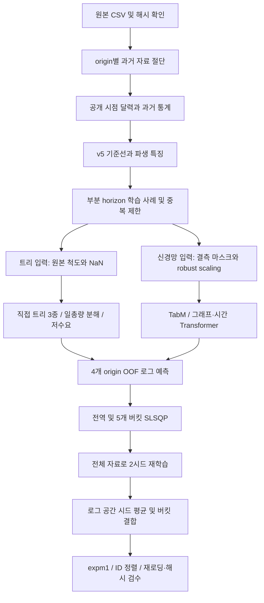

# SINCON 현재 파이프라인·모델 아키텍처·앙상블·Public 성적 상세

작성 기준: 2026-11-12 로컬 파일 확인 시점. 실제 저장된 코드·설정·CSV·JSON을 기준으로 기술한다. 새 학습을 수행한 보고서가 아니며, 완료된 최신 버전은 v5다. v6는 작업 중인 별도 소스로 분리한다.

## 1. 현재 상태를 먼저 구분

**최신 완주 버전은 ensemble_v5, 확인된 Public 최고 제출은 ensemble_v2(0.18265)**다. v5는 모델·OOF·최종 제출·재로딩 검수까지 완료했지만 Public 결과는 전달받지 않았다. v6는 별도 구현 작업 중이며 완료된 CV/제출 산출물이 없다. 이 문서 작성 시 staging의 v6에는 일정 연결용 `events.py` 등이 아직 없으므로 완성된 실행 가능 파이프라인으로 설명하지 않는다.

| 버전 | 전체 OOF | 가중 4-Fold | Fold 3+4 | 마지막 동일 구간/Fold 4 | 확인된 Public |
|---|---:|---:|---:|---:|---:|
| v1 LightGBM tuned | 비교 체계 다름 | 비교 체계 다름 | 비교 체계 다름 | 0.247808 | 0.21751 |
| v2 | 0.222761 | 0.220618 | 0.217365 | 0.224398 | **0.18265** |
| v3 | 0.222437 | 0.220529 | 0.217637 | 0.224364 | 미확인 |
| v4 | 0.221289 | 0.214121 | 0.202893 | 0.204816 | 0.18678 |
| v5 | 0.213516 | 0.206544 | 0.195621 | 0.194796 | 미확인 |
| v6 | 미완료 | 미완료 | 미완료 | 미완료 | 없음 |

v2는 v1보다 Public RMSLE가 0.03486(약 16.03%) 감소했다. v4는 v2보다 로컬 최근 구간 점수는 낮지만 Public은 0.00413(약 2.26%) 높아졌다. 로컬 점수 차이를 Public에 그대로 더하거나 빼는 환산식은 없다. v5는 v4 대비 Fold 3+4가 약 0.007272, Fold 4가 약 0.010020 개선됐다. 이는 저장된 검증 결과의 비교이며 테스트 개선 보장은 아니다.

v5 RESULTS.md 안의 과거 v3 Fold4 `nan`은 비교 리포트의 필드 추출 문제다. v3 자체 RESULTS.md에서 확인한 실제 값 0.224364를 위에 사용했다. v2 XGBoost의 과거 수정 전·후 숫자가 다른 문서에 남아 있어 이 문서의 v2 모델 표는 현재 ensemble_report.json을 기준으로 한다.

근거: [outputs/ensemble_v2/ensemble_report.json](/Users/hongtaeyang/Desktop/SINCON/outputs/ensemble_v2/ensemble_report.json), [outputs/ensemble_v3/RESULTS.md](/Users/hongtaeyang/Desktop/SINCON/outputs/ensemble_v3/RESULTS.md), [outputs/ensemble_v4/ensemble_report.json](/Users/hongtaeyang/Desktop/SINCON/outputs/ensemble_v4/ensemble_report.json), [outputs/ensemble_v5/ensemble_report.json](/Users/hongtaeyang/Desktop/SINCON/outputs/ensemble_v5/ensemble_report.json). Public은 사용자 제출 결과와 스크린샷에서 확인한 값이다.

## 2. 전체 처리 흐름



v5 소스는 `src/v5/`, 설정은 `configs/ensemble_v5.json`, 결과는 `outputs/ensemble_v5/`에 분리돼 있다. 다만 v5가 공유 `features_v3.py`, `models_v2.py`, `holiday_calendar.py`, `domain_events.py` 등을 가져오므로 재현 시 v5 폴더 하나만 복사해서는 부족하다. 입력·공유 소스·설정의 지문을 함께 보존해야 한다.

## 3. Local CV: 무작위 행 분할을 사용하지 않는 이유

| Fold | 예측 원점 | 검증 기간 | 검증 행 |
|---|---|---|---:|
| 1 | 2025-08-30 | 2025-08-31~2025-12-31 | 157,194 |
| 2 | 2025-10-30 | 2025-10-31~2026-03-02 | 157,194 |
| 3 | 2025-12-30 | 2025-12-31~2026-05-02 | 157,194 |
| 4 | 2026-02-27 | 2026-02-28~2026-06-30 | 157,194 |

총 628,776개의 **예측 사례**이며, 고유 관측 수가 그만큼 있다는 뜻은 아니다. 동일 날짜·역·시간이 서로 다른 origin의 검증에 등장한다. 4개 fold를 독립 표본처럼 취급하면 불확실성을 과소평가할 수 있다.

학습 원점 o는 2025-02-11부터 cutoff−14일까지 생성한다. 일반 간격은 14일, v5 Fold4는 7일로 더 촘촘하고 필요하면 끝 원점을 추가한다. 각 사례의 라벨 날짜는 `o < d ≤ min(o+123일, cutoff)`다. 따라서 123일 전체 라벨이 끝날 때까지 기다리지 않는 partial-horizon 방식이다. 입력 집계는 o 이하, 라벨은 해당 학습 cutoff 이하인 서로 다른 경계를 지킨다.

모든 train label을 검증 원점 123일 전까지만 제한하는 예전 방식은 최근 피처 스냅샷을 버렸다. 현재 최종 학습에는 2026-06-16 origin까지 포함되고 라벨은 6월 30일까지 사용된다. CV 밖의 미래 실제 승·하차를 사용하지 않는다.

지표는 다음처럼 구분한다.

- 전체 OOF: 모든 예측 사례의 로그 제곱오차 평균 후 제곱근.
- 가중 4-Fold: `sqrt(.15*MSE_F1+.15*MSE_F2+.35*MSE_F3+.35*MSE_F4)`.
- Fold 3+4: 해당 두 fold의 행을 합쳐 로그 MSE를 계산한 뒤 제곱근.
- Fold 4: 하나의 고정 미래 구간 점수.

폴드별 RMSLE에 가중치를 곱해 산술 평균하는 방식이 아니다. 모델 비교는 같은 행·같은 지표에서 해야 한다. 단일 모델의 Fold3 점수와 앙상블 전체 가중 점수를 비교해 우열을 판단할 수 없다.

## 4. 표본 생성과 타겟 중복 제한

같은 `(label_date, station_id, hour)`는 최대 3개 origin에서만 학습한다. horizon을 1~41일, 42~82일, 83~123일로 나누고 각 band에서 최대 1개 origin을 선택한다. 겨울·YoY 가용 구간을 맞추려고 동일 라벨을 여러 번 과도하게 복제하지 않는다.

선택 우선순위에 전년 정보 가용성을 고려하되 최종 추출은 계절 균형과 비복원 추출을 사용한다. 학습 가중치는 `n_yoy>=2`일 때 1.25, 나머지 1.0이다. 이는 앙상블 가중치와 다른 **학습 표본 가중치**다. 완전 균등 horizon 비율을 강제한 것은 아니므로 실제 horizon 빈도는 feature_audit.json을 확인한다.

| 구간 | 학습 행 | 원점 수 | 학습 rich 비율 | 평가/테스트 rich 비율 | 중복 상한 |
|---|---|---|---|---|---|
| fold_1 | 593724 | 15 | 0.00% | 10.58% | 3 |
| fold_2 | 827598 | 19 | 0.00% | 56.68% | 3 |
| fold_3 | 1061472 | 23 | 4.36% | 92.96% | 3 |
| fold_4 | 1200000 | 54 | 19.61% | 93.82% | 3 |
| final | 1600000 | 36 | 39.58% | 100.00% | 3 |


최종 후보 5,005,396행에서 중복 상한 적용 후 1,759,239행, 최종 사용은 1,600,000행이다. raw train 688,176행보다 많아지는 이유는 같은 과거 정답을 서로 다른 origin에서 예측하는 사례를 구성하기 때문이다. 최종 rich 비율 39.58%와 테스트 100%는 여전히 다르다.

행렬은 주로 pandas/NumPy와 float32를 사용한다. 초기 제안의 ‘모든 처리는 Polars lazy’가 실제 구현된 것으로 설명하지 않는다. 일총량·공간 모델은 완전한 18시간 station-day 블록이 필요해 별도 후보를 사용한다.

## 5. 기준선과 타겟: Anchor-residual

승차 로그값 `z_b=log1p(boardings)`, 하차 로그값 `z_a=log1p(alightings)`를 만들고 승차 잔차 `r_b=z_b−anchor_board_log`, 하차 잔차 `r_a=z_a−anchor_alight_log`를 학습한다. v5에서는 승차 anchor를 새 계절·체제 기준선으로 바꾼다.

### 5.1 기존 rolling 기저

공휴일·근로자의 날·개통 특수일·지정 급감 키를 제외한 과거에서 역×시간×유효요일별 로그 평균·중앙값·표준편차·개수를 28/56/112일 창으로 구한다. 공휴일은 근로자의 날을 제외하고 유효요일을 일요일(6)에 매핑한다.

`rolling_anchor_v2 = 0.6*clean_mean56 + 0.4*clean_mean28`.
56일 결측은 112일 → 노선×시간×유효요일 → 전체 시간×유효요일 → 사용 가능한 전체 평균 순으로 대체하고 28일이 없으면 대체된 기준을 쓴다. 원시 인원수 평균이 아닌 로그 평균이다.

### 5.2 v5 전년 커널과 스파이크 기댓값

전년 중심은 d−364일이다. 평시 기저는 ±14일 같은 역×시간×eff_dow의 삼각 가중 중앙값이고 표본 부족 시 ±21일로 확장한다. raw 기저는 ±21일 같은 역×시간×요일군의 균등 로그 평균이다. 요일군은 월/화~금/토/일·공휴일로 구분한다. raw 기저에서는 일회성 지정 마스크를 제외하되 행사성 큰 값을 일괄 제거하지 않는다.

```text
window_spike_amp = q90(z) - q50(z)  # 해당 전년 창 내부
alpha = clip((window_spike_amp - 0.45) / 0.45, 0, 1)
yoy_target = alpha * raw_mean + (1-alpha) * clean_median + delta_yoy_shrunk
```

과거 365일 전체를 써서 비시즌의 낮은 변동성이 시즌 진폭을 희석하지 않도록 목표 날짜 근처 창을 쓴다. 코드의 유효 표본 보조 값과 별개로 최종 결합이 항상 `n/(n+3)` 수축이라고 가정하지 않는다. v5는 전년 값이 있으면 위 혼합을 쓰고 결측 시 fallback을 쓴다.

### 5.3 개통 경계와 성장률

원점이 2025-07-28 이후이면 계양·귤현의 과거 특징 생성 입력에서 2025-07-01 이전 관측을 제거한다. 전년 중심이 2025-07-01 이후인 목표에 대해서는 모든 역의 전년 커널에서 그 이전 관측을 제거한다.

최근 56일과 364일 전의 대응 관측으로 성장률을 추정하되 비교 체제를 맞추고 최소 14개의 유효 날짜가 없으면 0을 사용한다. 유효 표본에 따라 `n/(n+12)` 수축을 적용한다. 최종 2026-06-30 origin은 개통 후 작년 대응 창이 충분하지 않으므로 테스트의 `delta_yoy_shrunk`는 전부 0임이 감사 JSON에 기록돼 있다. 이를 데이터가 없는 성장률의 확정 추정값으로 해석하지 않는다.

### 5.4 신설역·휴일·fallback

신설역은 일반 전년 커널 대신 최근 56일을 기존 66개 역의 노선·시간·유효요일 계절 지수로 탈계절화한 뒤 주간 robust 기울기를 구한다. 기울기 범위는 0~0.015/week, 미래 누적 증가에는 0.90 감쇠를 적용한다. 여기에 노선의 전년 계절 변화량을 사용한다. 여름에도 계속 동일 기울기로 성장시킨다는 가정을 억제한다.

5월 1일은 2025-05-01 실측과 그 직전 56일 정제 평일 중앙값의 로그 차이를 `[-1.8,+0.8]`로 제한하고 역 85%+노선 15%로 혼합해 기저에 추가한다. 원점이 2025-05-02 이후인 경우에만 이용한다. 다른 공휴일·명절은 종류별 과거 수요와 당시 직전 일반 일요일 중앙값의 차이를 표본 수에 따라 노선 평균으로 수축한다.

YoY가 없는 일반 셀의 fallback에는 rolling과 Fourier Ridge를 혼합한다. 현재 v5 Fourier는 연간 sin/cos 1~3차와 범주 원핫을 쓰는 Ridge(alpha=50, lsqr)이며 **충분한 연간 이력 330일 게이트가 없다.** 짧은 이력에서 연간 외삽이 불안정할 수 있어 v6 수정 대상으로 남아 있다. 수정 예정 내용을 v5에 이미 적용한 것으로 쓰지 않는다.

### 5.5 주요 입력 특징군

| 특징군 | 실제 입력과 의미 |
|---|---|
| 개체·교차 범주 | station_id, canonical_line, hour, dow, eff_dow, holiday_subtype, station_hour, station_eff_dow |
| 달력 | 월·연중일·horizon·요일·주말·sin/cos 시간 주기·공휴일·대체·선거·명절 상대일 |
| 정제 rolling | 승·하차 로그 mean/median/std/count × 28/56/112일 |
| 휴일 프로필 | cal_dow_log_mean, sun_log_mean, sun_minus_wkd_log, holiday elasticity |
| 단기 변화 | 28일−112일 로그 평균, 승하차 비대칭, 시간 점유율 |
| 전년 단일 날짜 | year364_clean_log; 정상 관측 우선 d−364, 대체 d−357/d−371, 결측 표시 |
| 전년 계절 | yoy_seas_log_delta, yoy_smooth15_log_delta, raw/clean 전년 커널·분위수·표본 수 |
| v5 기준선 | anchor_v5, rolling_anchor_v2, 두 값 차이, delta_yoy_shrunk, 신설역 추세 |
| 연결 | 같은 노선 ID±1의 기준선·추세, 3대 환승 쌍 상대 수요·비율 |
| 역 특성 | 오전·오후 승하차 비대칭, 외부 노선 환승 여부 |
| 도메인 | 펜타포트 사전 일정, 성묘×역×시간, 학기/방학 proxy, 과거 하차 급증 관련 기대값 |

단일 날짜의 전년 값과 월 계절 피처는 v5에서도 보존한다. 미래 실제 하차량·날씨·example_id는 입력하지 않는다. 여러 특징이 강하게 상관되어도 트리에는 일괄 정규화나 임의 제거를 강제하지 않는다.

## 6. 트리와 신경망 전처리

트리는 수치 변수를 원래 파생변수 척도의 float32로 유지하고 NaN을 그대로 전달한다. CatBoost 범주는 문자열로 변환하며 결측 범주는 -1 문자열로 처리한다. LightGBM/XGBoost는 학습 시 관측한 범주 목록을 저장한 pandas categorical을 사용한다. v5에서는 LGB/XGB가 `station_eff_dow`만 제외하고 `station_hour`는 유지한다. CatBoost는 둘 다 유지한다.

신경망은 각 학습 fold 안에서만 연속 변수의 **원래 유효 관측**으로 median과 IQR을 적합한다. 결측 플래그를 먼저 보존하고, year364 승차 수준 피처는 행별 승차 anchor, 하차 수준 피처는 하차 anchor로 채운 뒤 나머지는 학습 median으로 채운다. `(x−median)/(IQR+1e-5)` 후 [-10,10]으로 제한한다. 원래 결측 마스크를 별도 채널로 붙인다. 극소 표본·상수 열은 안전한 척도로 처리하고 상수 열 변환값은 0으로 한다.

범주 인덱스 0은 미지 토큰이며 학습에서 본 범주를 1부터 매핑한다. 평가·테스트에서 scaler나 category map을 다시 적합하지 않는다. 구현은 [src/v5/preprocessing.py](/Users/hongtaeyang/Desktop/SINCON/src/v5/preprocessing.py).

## 7. 7개 모델군의 아키텍처·손실·설정

### 7.1 LightGBM 직접 잔차 모델

리프 중심 비대칭 GBDT다. 목표는 승차 로그 잔차 L2(`regression_l2`), 검증은 잔차 RMSE다. `num_leaves=191`, `min_child_samples=20`, `lr=0.02`, `subsample=0.8`, `subsample_freq=1`, `colsample_bytree=0.8`, `reg_alpha=0.3`, `reg_lambda=3`, `cat_smooth=15`, `cat_l2=10`, `extra_trees=False`, 최대 6,000 boosting rounds다. CPU에서 deterministic/force_col_wise 설정을 사용한다.

`linear_tree=True`는 현재 설정이 아니다. 트리 모델의 분할은 AdamW로 학습하지 않는다. 반복 수는 신경망 epoch가 아니라 누적 boosting round다.

### 7.2 CatBoost CPU 직접 잔차 모델

대칭 트리와 범주 처리 기반의 잔차 회귀다. `depth=8`, `lr=0.025`, `l2_leaf_reg=5`, `random_strength=0.8`, 최대 6,000회, `loss_function=RMSE`다. 교차 범주 station_hour/station_eff_dow를 cat_features로 전달한다. v5의 `catboost_cpu`는 GPU가 있어도 CPU로 고정한다.

별도 `boosting_type=Ordered`를 명시한 것은 아니므로 모든 설정을 순서형 boosting으로 단정하지 않는다. CPU/GPU CatBoost는 내부 기본값·연산이 달라 GPU 전환만으로 동일 모델이 재현된다고 볼 수 없다.

### 7.3 XGBoost 직접 잔차 모델

히스토그램 기반 트리(`tree_method=hist`)와 범주 분할을 사용한다. `max_depth=8`, `min_child_weight=20`, `lr=0.02`, `subsample=0.8`, `colsample_bytree=0.8`, `reg_alpha=0.3`, `reg_lambda=3`, `max_cat_to_onehot=4`, `max_cat_threshold=64`, 최대 6,000회. 목표는 `reg:squarederror`, 평가 rmse다.

CUDA 장치가 있으면 CUDA를 사용하며 두 장 환경에서는 가능한 두 번째 장치를 선택하는 코드가 있다. 현재 RunPod 한 장 환경에서는 cuda:0이다. 호환 래퍼는 평가와 추론의 반복 범위를 맞추는 역할을 한다.

### 7.4 Multi-task TabM 스타일 BatchEnsemble

외부 TabM 패키지를 쓰지 않는 자체 PyTorch 구현이다. 원 논문의 모든 세부를 재현했다고 주장하지 않는다.

1. 연속형 변수마다 학습 가능한 주파수 8개를 곱해 sin/cos 확장한다. 원래 결측 마스크는 직접 채널로 전달한다.
2. 범주형은 `Embedding(cardinality, min(16,max(2,ceil(sqrt(cardinality)))))`, 미지 인덱스 0을 사용한다.
3. K=16개의 멤버를 갖는 3개 BatchEnsemble 블록. hidden=384, rank-1 입력/출력 곱셈 어댑터와 멤버별 bias, LayerNorm → SiLU → Dropout(0.2).
4. 공유 선형 출력층으로 `(batch,16,2)`를 반환한다. 채널 0 승차 잔차, 1 하차 잔차.

각 멤버별로 승차 MSE+0.2×하차 MSE를 계산한 뒤 멤버와 표본에 대해 평균한다. **멤버 예측을 먼저 평균해 손실을 계산하지 않는다.** 표본 rich 가중치도 적용한다.

AdamW(lr=0.0015, weight_decay=0.0003), batch=2048, 최대 35 epochs, patience=7. 초기 3epoch linear warmup 이후 cosine 감소, 하한 1e-5, gradient norm clip=5. CUDA에서만 FP16 autocast+GradScaler, CPU/MPS FP32. 비유한 손실은 오류로 처리한다.

추론은 하차 채널을 버리고 각 멤버의 `max(0,anchor+residual)`을 계산한 뒤 16개 **로그 예측**을 평균한다. 모델 두 시드도 로그 공간에서 평균한다.

### 7.5 일총량 × 시간 점유율 분해 GBDT

`decomp_gbdt`는 단일 트리 한 개가 아니라 3개 회귀기의 묶음이다.

- 일총량: 18시간 실제 승차 합의 log1p에서 일총량 anchor를 뺀 잔차를 LightGBM과 CatBoost CPU가 각각 학습한다. 둘의 일총량 로그 예측을 동일 비율 평균한다.
- 시간 점유율: `(y_h+0.5)/(일총량+9)`의 로그 비율에서 anchor softmax 로그 비율을 뺀 잔차를 별도 LightGBM이 학습한다.
- 추론: 18개 logits에 softmax를 적용하고 `(예측 일총량+9)*share−0.5`를 계산한 뒤 0 미만을 절삭한다.

점유율 softmax 합은 1이다. 마지막 인원수 비음수 절삭 때문에 복원된 시간별 합이 예측 일총량과 완전히 같지 않을 수 있다. 입력 블록은 hour 6~23 정렬된 완전한 18행이어야 한다. 일 단위 입력은 시간 피처 일부를 제거하고 다른 변수는 시간축 평균으로 축약한다. 점유율 모델은 최대 60,000개 일 블록을 선택한다.

### 7.6 저수요 전문 모델

LightGBM(leaves95, min_child8, L2=1)과 CatBoost(depth6,L2=1)의 로그 예측 평균이다. 학습 gate는 `anchor_v5<3.3 또는 hour>=21`. 나머지 하이퍼파라미터는 직접 트리 기본값을 상속한다.

학습하지 않은 구간에서 wrapper가 anchor를 반환하더라도 블렌더가 이를 일반 구간에 섞지 못하도록 **late_or_low 외 모든 버킷의 가중치를 0으로 고정**한다. 블렌더 버킷의 저수요 기준은 3.2로 학습 gate 3.3과 다르다. 이번 최종 최적화에서는 허용된 late_or_low에서도 가중치 0으로 선택돼 **실제 제출 기여는 없다.** 모델군 전체 OOF는 off-gate 기준선 반환을 포함하므로 전문 구간만의 실력을 나타내는 지표가 아니다.

### 7.7 자체 그래프·시간 Transformer (`st_itransformer`)

파일명과 모델 키는 st_itransformer이지만 구현은 원 논문 iTransformer의 재현이 아니다. 역 연결과 주간 패치 시간 attention을 조합한 자체 네트워크다.

- 과거 56일 × 18시간, 승차 log1p/8·관측 마스크·하차 log1p/8·관측 마스크의 4채널.
- 자기 연결·동일 노선 인접 ID·3대 환승 쌍 그래프를 행 정규화해 이웃 평균 4채널을 추가, 총 8채널.
- 7일×18시간×8채널=1,008차원의 주간 patch 8개를 96차원으로 투영하고 학습 위치 임베딩 추가.
- TransformerEncoder 2층, attention heads4, feedforward192, GELU, dropout0.15. 8개 시간 토큰을 평균해 과거 표현을 얻는다.
- 미래 18시간의 robust 수치·마스크·정규화된 범주 인덱스를 별도 96차원으로 투영. 과거 표현과 합쳐 192→96→1 회귀 헤드로 각 시간 승차 잔차를 출력한다.

AdamW lr=0.001, weight_decay=0.0003, 최대30epochs, batch512 station-days, patience7, cosine 하한1e-5, gradient clip5, CUDA FP16+GradScaler. 손실은 승차 MSE이며 TabM과 달리 미래 하차 보조 출력은 없다. 최대120,000개의 완전한 station-day 후보를 사용한다. 과거 context와 해당 origin 정보도 저장 모델에 포함한다.

## 8. 최대 반복 수와 실제 학습 횟수

트리 early stopping patience는 250회다. 최적 반복 수는 가장 좋은 검증 지점을 뜻하고 실제 실행은 이후 patience를 확인하느라 더 진행된다. 저장 모델·추론은 최적 반복 범위를 사용한다.

| 모델 | F3 최적 | F4 최적 | 최종 고정 반복/epoch(각 시드) |
|---|---|---|---|
| lightgbm | 43 | 28 | 35 |
| catboost_cpu | 29 | 21 | 26 |
| xgboost | 39 | 40 | 44 |
| tabm_v5 | 1 | 4 | 4 |
| decomp_gbdt | 25 | 78 | 86 |
| low_demand_specialist | 471 | 262 | 328 |
| st_itransformer | 2 | 4 | 4 |


최종 반복 수 구현:

```python
round(min(best4 * 1.25,
          max(best4, 0.3 * best3 + 0.7 * best4) * 1.10))
```

v5 config에 남은 기존 `final_iteration_multiplier=1.12` 등보다 위 v5 전용 함수와 실제 plan이 우선한다. decomp/low의 best는 내부 하위 모델 best 중 최댓값으로 대표되며, 위 표를 모든 하위 모델의 CV best가 같다는 뜻으로 읽지 않는다.

**요청했던 직접 트리 400회·TabM 8epoch 진단 기준을 v5 F3/F4는 충족하지 못했다.** 이를 숨기거나 강제로 횟수를 늘려 정상 수렴했다고 기록하지 않는다. 낮은 best만으로 과적합·미수렴을 확정할 수는 없지만 짧은 원점 이력·기준선/잔차 분포 차이·스케줄러 등의 점검 필요가 남는다.

반 학습률 재진단의 best는 F3 LGB75/Cat45/XGB79/TabM3, F4 LGB88/Cat42/XGB92/TabM4다. 이 8개 진단 모델은 원래 CV/최종 모델을 교체하지 않았다. 따라서 진단 점수가 더 좋았다고 가정해 최종 성능을 설명하면 안 된다.

신경망 CV는 검증 손실 상위 3개 checkpoint의 **파라미터 평균**을 저장한다. 최종 전체 학습은 별도 검증 라벨이 없으므로 예정된 마지막 3개 epoch 파라미터를 평균한다. 이를 ‘최종에서도 검증 Top-3’라고 부르지 않는다. 최종 내부 28일 검증 slice는 config에 항목이 있지만 이 완료 실행에서 별도 적합·모니터 결과로 구현된 것으로 확인되지 않는다.

트리·신경망 어느 쪽도 전역 최적점 도달을 보장하지 않는다. 최적값은 이 후보·검증·학습 경로 안에서 관찰한 값이다.

## 9. v5 단일 모델과 앙상블 성능

| 모델 | 전체 OOF | 가중 4-Fold | Fold 3+4 | Fold 4 |
|---|---|---|---|---|
| lightgbm | 0.224202 | 0.215555 | 0.201893 | 0.204108 |
| catboost_cpu | 0.224765 | 0.217775 | 0.206847 | 0.205485 |
| xgboost | 0.223991 | 0.215840 | 0.203000 | 0.202523 |
| tabm_v5 | 0.222060 | 0.214085 | 0.201532 | 0.194900 |
| decomp_gbdt | 0.239250 | 0.230529 | 0.216791 | 0.201309 |
| low_demand_specialist | 0.262052 | 0.244259 | 0.214825 | 0.211623 |
| st_itransformer | 0.246452 | 0.232196 | 0.208996 | 0.204113 |
| v5 global | 0.216000 | 0.208639 | 0.197083 | 0.195088 |
| v5 bucket ensemble | 0.213516 | 0.206544 | 0.195621 | 0.194796 |


동일 Fold3+4에서는 TabM 단일 0.201532보다 버킷 앙상블 0.195621이 낮다. Fold4는 TabM 0.194900과 앙상블 0.194796의 차이가 약 0.000104로 작다. 이 수치를 전체 다른 구간 점수와 섞어 해석하지 않는다. 최근 구간 한 모델이 좋아도 다른 계절과 역의 잔차를 보완하는 모델은 앙상블에 남을 수 있다.

## 10. 가중치 학습의 목적함수와 제약

모든 모델 출력은 `z_hat=log1p(prediction)` 공간에서 결합한다.

$$\hat z_i=\sum_m w_{b(i),m}\hat z_{i,m},\quad w\ge0,\quad\sum_mw_m=1.$$

전역 목적은 `0.35*가중4Fold_logMSE + 0.65*Fold34_logMSE`다. 버킷별로는 전역 가중치와의 L2 차이에 **0.0005**를 곱해 수축항을 더한다. 제미나이 제안의 0.02가 실제 v5 값은 아니다. 각 버킷 안에서는 fold별 행 수로 다시 정규화한다. 모든 fold가 있는 경우 두 목적을 합친 대략적인 fold 질량은 0.0525/0.0525/0.4475/0.4475다.

SLSQP에 해석적 gradient, ftol=1e-12, maxiter=1000을 사용한다. 상수 절편은 없다. 제약은 다음과 같다.

- 전역·regular에서 직접 트리 LGB+Cat+XGB 합계 ≥20%.
- new_stations에서 공간 Transformer ≤45%.
- low_demand_specialist는 late_or_low만 후보, 나머지0.
- 모든 가중치 0 이상, 합계1.

단일 모델마다 자신에게 유리했던 fold에서 개별 가중치를 가져와 붙이지 않는다. 가중치는 여러 모델 잔차의 공분산까지 반영하는 공동 최적화 결과다. 다른 표본에서 구한 비율들을 섞으면 동일 목적함수의 최적해가 아니며 검증 선택 편향이 커진다.

## 11. 최종 제출에 실제 사용한 5-Bucket 가중치

버킷은 아래 **우선순위 순서**로 단 한 곳에 배정한다. 미래 정답은 사용하지 않는다.

1. new_stations: 3107/3108/3109.
2. gyeyang_gyulhyeon: 위 제외, 3110/3111.
3. high_spike: 위 제외, 과거 전년창 진폭 ≥0.65.
4. late_or_low: 위 제외, hour≥21 또는 anchor_v5<3.2.
5. regular: 나머지.

| 버킷 | LGB | Cat CPU | XGB | TabM | 분해 GBDT | 저수요 | 공간 Transformer |
|---|---|---|---|---|---|---|---|
| new_stations | 0.0000% | 0.0000% | 29.5769% | 23.7452% | 46.6779% | 0.0000% | 0.0000% |
| gyeyang_gyulhyeon | 0.0000% | 0.0000% | 0.0000% | 41.5672% | 40.7026% | 0.0000% | 17.7303% |
| high_spike | 16.8612% | 32.9540% | 0.0000% | 3.8926% | 46.2922% | 0.0000% | 0.0000% |
| late_or_low | 0.0000% | 36.0339% | 0.0000% | 63.9661% | 0.0000% | 0.0000% | 0.0000% |
| regular | 30.5930% | 14.6931% | 0.0000% | 46.8264% | 0.0000% | 0.0000% | 7.8875% |


표는 % 단위 반올림이므로 합계에서 끝자리 차이가 생길 수 있다. JSON에는 원래 정밀도의 값이 있다. 전역 가중치는 비교·수축 prior용이며 제출 전체에 하나로 적용한 비율이 아니다.

| 전역 모델 | 비중 |
|---|---|
| lightgbm | 29.577485% |
| catboost_cpu | 10.193752% |
| xgboost | 2.334319% |
| tabm_v5 | 51.046268% |
| decomp_gbdt | 6.848176% |
| low_demand_specialist | 0.000000% |
| st_itransformer | 0.000000% |


최종 제출은 7개 모델군 × 2개 seed의 로그 예측을 먼저 모델군별로 평균하고, 해당 행의 버킷 가중치를 적용한다. 7개 군 모두가 최종 비중을 갖는 것은 아니다. 저수요는 0, XGB는 신설역에서만, 공간 모델은 계양·귤현과 regular에서만 기여한다.

## 12. 앙상블 성능 검증의 한계와 교차 점검

같은 OOF로 가중치를 학습하고 그 위에서 점수를 계산하면 앙상블 선택 자체에 대한 적합 점수다. 독립 미래 검증이라고 부르면 안 된다.

| 별도 점검 | RMSLE |
|---|---:|
| 날짜 purge F3→F4 전역 | 0.198597 |
| 날짜 purge F3→F4 버킷 | 0.198958 |
| 날짜 중복 제거 LOFO 전역 | 0.217271 |

purged 점검은 Fold3 중 Fold4와 겹치는 날짜를 제외한 75,402행으로 가중치를 구하고 Fold4 157,194행에 적용한다. 여기서는 버킷이 전역보다 약 0.000361 나쁘다. 따라서 최종 적합 OOF에서 버킷이 낮다는 이유만으로 항상 더 잘 일반화한다고 주장하지 않는다. 이 결과를 보고 Fold4 전용 fallback을 사후 선택하지 않았다.

7일 embargo를 둔 forward 날짜 블록 점수도 JSON에 기록되어 있다. 직접 트리 20% 하한은 일부 초기 블록에서 개선, 후반 블록에서는 동일했다. F3→F4에서는 제약이 없어도 직접 트리 합이 이미20% 이상이라 두 결과가 같다.

기본 모델은 각 fold validation으로 early stopping 했고 특징 설계에도 이전 분석이 반영됐다. meta 단계의 날짜 purge만으로 전체 학습 과정이 완전 nested 검증이 되는 것은 아니다. LOFO는 남은 fold에 더 늦은 날짜가 들어갈 수도 있다.

잔차 상관 행렬은 [outputs/ensemble_v5/step_b_residual_correlation.csv](/Users/hongtaeyang/Desktop/SINCON/outputs/ensemble_v5/step_b_residual_correlation.csv)에 있다. 상관 0.95 넘으면 자동 제거한다는 예전 일반 지침을 현재 가중치 학습의 하드 규칙으로 적용하지 않는다. 높은 상관도 공통 예측 불가능 충격을 반영할 수 있고 작은 보완성이 남을 수 있다.

## 13. Public 최고인 v2의 정확한 구성

v2도 로그 anchor 잔차 모델이며 최종 seed2026/2027 두 개를 평균했다. 최종 가중치는 다음과 같다.

| 모델 | 가중치 % | 전체 OOF | 가중 OOF | F3+4 |
|---|---|---|---|---|
| lightgbm | 3.244835 | 0.226913 | 0.227396 | 0.228119 |
| catboost | 60.231669 | 0.223302 | 0.222271 | 0.220714 |
| xgboost | 0.000000 | 0.229774 | 0.231022 | 0.232881 |
| tabm | 36.523496 | 0.229376 | 0.225352 | 0.219177 |


XGBoost 수치 5.1e-17은 사실상 0이다. 따라서 Public0.18265는 실질적으로 CatBoost60.23%+TabM36.52%+LGB3.24%의 로그 앙상블이다. 로컬 CPU/MPS 환경에서 생성한 결과이며 v3 GPU 모델과 조건이 같지 않다.

| 모델 | v2 설정 | 실제 최종 반복 |
|---|---|---:|
| LGB | leaves159,min_child25,lr.03,L1=0.5,L2=5,subsample.8,colsample.8,max3000,patience150 | 2,464 |
| CatBoost | depth8,lr.04,L2=5,random_strength1,max3500,patience150 | 3,169 |
| XGB | hist,depth8,min_weight20,lr.03,L1=0.5,L2=5,subsample.8,colsample.75,max3000,patience150 | 2,042 |
| TabM | K8,hidden256,3blocks,4frequencies,dropout.15,AdamWlr.001,wd1e-4,batch4096,max30,patience5,aux.2 | 13 epochs |

설정 원문 JSON도 아래에 수록한다. v2 TabM도 범주 embedding·주기 수치 embedding·rank-1 어댑터·2채널 출력 구조다. v5와 달리 소규모 K8/hidden256이고 v5의 warmup·Top3 변경을 소급 적용하지 않는다.

v2는 최대 폴드80만/최종100만 행, 기존 .5/1.5/2.5 origin 가중 표본, 4개 expanding origins, rolling clean anchor가 중심이었다. 최종 반복은 `1.12*(.4*bestF3+.6*bestF4)`에서 정해졌다. v5의 기준선·중복3회·버킷 제약은 v2에 없었다.

### v1·공식 베이스라인과의 관계

v1 최종 LGB는 leaves127,min_child80,lr.055,L1=.1,L2=10,subsample.75,colsample.9,173trees다. 1000회 상한·patience100의16후보 개발 탐색 결과173회가 선택됐고 AdamW를 쓰지 않았다. 제출 파일명 `submission_lgbm_0.247808.csv`의 숫자는 로컬 비교 점수다.

운영진 원본 시작 코드는 ‘최근8주 같은 요일·시간 평균’이며 실제 보존 원본 실행의 검증 기간은 2026-03-01~06-30(122일), 로컬0.3077006623이다. 운영진 표기 Public0.28264는 별도 출처 값이며 여기서 새 제출한 측정이 아니다. 초기0.291005는 자체 seasonal7의 다른 cutoff 결과이고 공식 baseline 점수로 부르면 안 된다.

## 14. 자원·재현성·수행 범위

v5 실행 기록은 2,361.958초, 4fold×7군=28개 CV bundle, 2seed×7군=14개 최종 bundle, 추가 반 학습률8개 진단이다. decomp/low 내부에 복수 트리가 있으므로 이것을 총 tree estimator 개수라고 부르지 않는다.

RunPod 작업은 RTX PRO4500 Blackwell 32GB와 실효 CPU 약10.2코어를 기준으로 CPU2작업×각5스레드, GPU작업 직렬로 구성했다. GPU 표가 `device=cpu`로만 기록된 일부 CSV는 모델을 CPU 저장 형태로 옮긴 뒤 기록한 값이라 훈련 장치를 그대로 나타내지 않는다. 장치 사용은 모델 정책·실행 환경·로그를 함께 본다.

같은 RunPod 환경의 저장 manifest에는 Python3.12.3, torch2.8.0+cu128, CUDA12.8, LightGBM4.7.0, CatBoost1.2.10, XGBoost3.4.1이 기록돼 있다. 이는 별도 v4 runtime manifest에서 확인한 환경이며 v5 고유 전체 버전 manifest로 오인하지 않는다. v2 로컬 manifest는 Python3.12.14, torch2.15.0, macOS/MPS다. 이 문서가 오늘 새 GPU 연결 성공이나 동일 하드웨어 재확보를 뜻하지 않는다.

14개 모델을 별도 프로세스에서 재로딩한 로그 예측 차이는 모두0, 최종 CSV도 byte-identical이었다. 로컬 복구 검수는507파일/452,015,883bytes, missing0/hash mismatch0을 기록한다. 원격 GPU 종료 여부와 별개로 이 v5 산출물은 로컬에 존재한다.

## 15. 파일 지도와 설정 원문

| 역할 | 파일 |
|---|---|
| 통합 실행 | [src/v5/pipeline.py](/Users/hongtaeyang/Desktop/SINCON/src/v5/pipeline.py) |
| 샘플링 | [src/v5/data.py](/Users/hongtaeyang/Desktop/SINCON/src/v5/data.py) |
| 기준선·피처 | [src/v5/features.py](/Users/hongtaeyang/Desktop/SINCON/src/v5/features.py) / [src/features_v3.py](/Users/hongtaeyang/Desktop/SINCON/src/features_v3.py) |
| 트리·분해·저수요 | [src/v5/models.py](/Users/hongtaeyang/Desktop/SINCON/src/v5/models.py) |
| TabM / 공간망 | [src/v5/tabm.py](/Users/hongtaeyang/Desktop/SINCON/src/v5/tabm.py) / [src/v5/spatial.py](/Users/hongtaeyang/Desktop/SINCON/src/v5/spatial.py) |
| NN 전처리 | [src/v5/preprocessing.py](/Users/hongtaeyang/Desktop/SINCON/src/v5/preprocessing.py) |
| 앙상블 | [src/v5/ensemble.py](/Users/hongtaeyang/Desktop/SINCON/src/v5/ensemble.py) |
| OOF | [outputs/ensemble_v5/step_b_oof.csv.gz](/Users/hongtaeyang/Desktop/SINCON/outputs/ensemble_v5/step_b_oof.csv.gz) |
| 최종 모델 | [outputs/ensemble_v5/final](/Users/hongtaeyang/Desktop/SINCON/outputs/ensemble_v5/final) |
| 학습 기록 | [outputs/ensemble_v5/cv_training_budget.csv](/Users/hongtaeyang/Desktop/SINCON/outputs/ensemble_v5/cv_training_budget.csv) |
| 수렴 진단 | [outputs/ensemble_v5/convergence_review.json](/Users/hongtaeyang/Desktop/SINCON/outputs/ensemble_v5/convergence_review.json) |
| 공식 baseline 측정 | [official_baseline/reports/measurement.json](/Users/hongtaeyang/Desktop/SINCON/official_baseline/reports/measurement.json) |

v5 설정 전체(설정값과 실제 채택 반복 수는 위 표처럼 구분):

```json
{
  "version": "ensemble_v5",
  "seed": 2026,
  "final_seeds": [
    2026,
    2027
  ],
  "fold_origins": [
    "2025-08-30",
    "2025-10-30",
    "2025-12-30",
    "2026-02-27"
  ],
  "fold_weights": [
    0.15,
    0.15,
    0.35,
    0.35
  ],
  "horizon_days": 123,
  "final_cutoff": "2026-06-30",
  "max_training_rows": 1200000,
  "final_training_rows": 1600000,
  "threads": 5,
  "max_cpu_workers": 2,
  "device": "auto",
  "models": [
    "lightgbm",
    "catboost_cpu",
    "xgboost",
    "tabm_v5",
    "decomp_gbdt",
    "low_demand_specialist",
    "st_itransformer"
  ],
  "patience": 250,
  "lightgbm": {
    "num_leaves": 191,
    "min_child_samples": 20,
    "learning_rate": 0.02,
    "subsample": 0.8,
    "subsample_freq": 1,
    "colsample_bytree": 0.8,
    "reg_alpha": 0.3,
    "reg_lambda": 3,
    "n_estimators": 6000,
    "cat_smooth": 15,
    "cat_l2": 10,
    "extra_trees": false
  },
  "catboost": {
    "depth": 8,
    "learning_rate": 0.025,
    "l2_leaf_reg": 5.0,
    "random_strength": 0.8,
    "iterations": 6000
  },
  "xgboost": {
    "tree_method": "hist",
    "enable_categorical": true,
    "max_cat_to_onehot": 4,
    "max_depth": 8,
    "min_child_weight": 20,
    "learning_rate": 0.02,
    "subsample": 0.8,
    "colsample_bytree": 0.8,
    "reg_alpha": 0.3,
    "reg_lambda": 3,
    "n_estimators": 6000,
    "max_cat_threshold": 64
  },
  "tabm": {
    "k": 16,
    "hidden": 384,
    "blocks": 3,
    "frequencies": 8,
    "dropout": 0.2,
    "learning_rate": 0.0015,
    "weight_decay": 0.0003,
    "batch_size": 2048,
    "epochs": 35,
    "patience": 7,
    "auxiliary_weight": 0.2
  },
  "final_iteration_multiplier": 1.12,
  "final_iteration_fold_weights": [
    0.25,
    0.75
  ],
  "selection_metric": "mixed_log_mse",
  "ensemble_bias": false,
  "input_data": "data/raw",
  "output": "outputs/ensemble_v5",
  "feature_workers": 4,
  "budget_seconds": 7200,
  "st_itransformer": {
    "epochs": 30,
    "batch_size": 512,
    "hidden": 96,
    "patience": 7,
    "learning_rate": 0.001
  },
  "max_origins_per_target": 3,
  "convergence_min_tree": 400,
  "convergence_min_tabm": 8,
  "convergence_lr_retries": 1,
  "direct_tree_min_weight": 0.2,
  "new_station_spatial_max_weight": 0.45,
  "final_diagnostic_origin": "2026-06-02",
  "final_diagnostic_end": "2026-06-30",
  "checkpoint_average": 3,
  "blend_weighted_mse_share": 0.35,
  "blend_fold34_mse_share": 0.65
}
```


Public 최고 v2 설정 전체:

```json
{
  "version": "ensemble_v2",
  "seed": 2026,
  "final_seeds": [
    2026,
    2027
  ],
  "fold_origins": [
    "2025-08-30",
    "2025-10-30",
    "2025-12-30",
    "2026-02-27"
  ],
  "fold_weights": [
    0.15,
    0.15,
    0.35,
    0.35
  ],
  "horizon_days": 123,
  "final_cutoff": "2026-06-30",
  "max_training_rows": 800000,
  "final_training_rows": 1000000,
  "threads": 4,
  "max_cpu_workers": 2,
  "device": "auto",
  "models": [
    "lightgbm",
    "catboost",
    "xgboost",
    "tabm"
  ],
  "patience": 150,
  "lightgbm": {
    "num_leaves": 159,
    "min_child_samples": 25,
    "learning_rate": 0.03,
    "subsample": 0.8,
    "subsample_freq": 1,
    "colsample_bytree": 0.8,
    "reg_alpha": 0.5,
    "reg_lambda": 5.0,
    "n_estimators": 3000
  },
  "catboost": {
    "depth": 8,
    "learning_rate": 0.04,
    "l2_leaf_reg": 5.0,
    "random_strength": 1.0,
    "iterations": 3500
  },
  "xgboost": {
    "tree_method": "hist",
    "enable_categorical": true,
    "max_cat_to_onehot": 4,
    "max_depth": 8,
    "min_child_weight": 20,
    "learning_rate": 0.03,
    "subsample": 0.8,
    "colsample_bytree": 0.75,
    "reg_alpha": 0.5,
    "reg_lambda": 5.0,
    "n_estimators": 3000
  },
  "tabm": {
    "k": 8,
    "hidden": 256,
    "blocks": 3,
    "frequencies": 4,
    "dropout": 0.15,
    "learning_rate": 0.001,
    "weight_decay": 0.0001,
    "batch_size": 4096,
    "epochs": 30,
    "patience": 5,
    "auxiliary_weight": 0.2
  },
  "final_iteration_multiplier": 1.12,
  "final_iteration_fold_weights": [
    0.4,
    0.6
  ],
  "selection_metric": "weighted_fold_rmsle",
  "ensemble_bias": false,
  "input_data": "data/raw",
  "output": "outputs/ensemble_v2"
}
```


## 16. 다음 실험과 혼동하지 말아야 할 점

v6 외부 일정 확대·Fourier 이력 게이트·추론 감사를 위한 수정은 진행 중이다. 이 문서의 점수는 그 변경을 학습한 결과가 아니다. 기존 v1~v5 결과는 보호하며 새 버전의 효과는 별도 OOF·제출·해시로 확인해야 한다. v5의 짧은 best iteration, 버킷의 purged 성능, 공간 모델 구조 명칭, 이벤트 누락은 남은 한계로 명시한다.

관련 문서: [대회](/Users/hongtaeyang/Desktop/SINCON/reports/current_pipeline_20261112/01_COMPETITION.md) · [데이터·EDA](/Users/hongtaeyang/Desktop/SINCON/reports/current_pipeline_20261112/02_DATA_EDA.md) · [추론·후처리](/Users/hongtaeyang/Desktop/SINCON/reports/current_pipeline_20261112/04_INFERENCE_AND_POSTPROCESSING.md)
