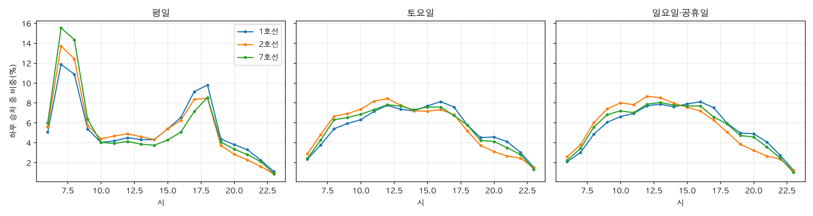
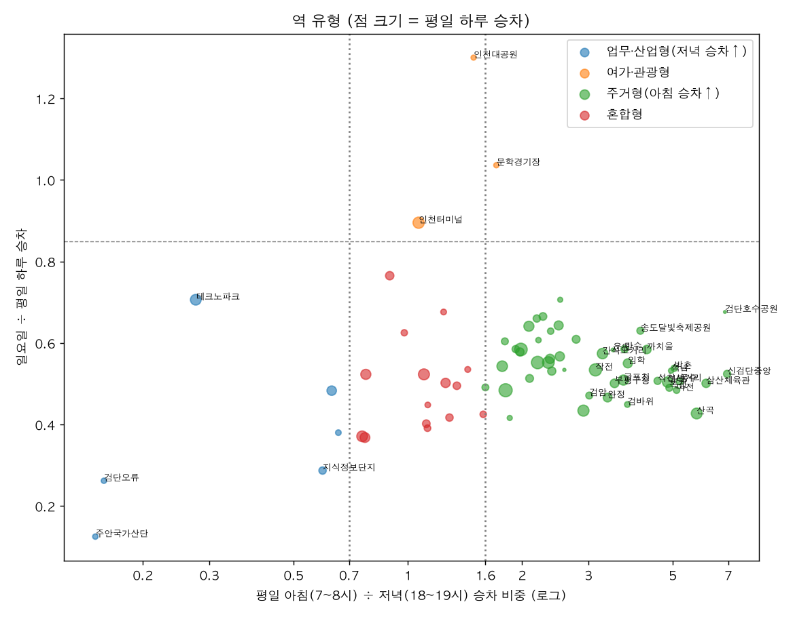
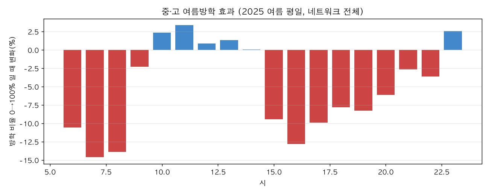
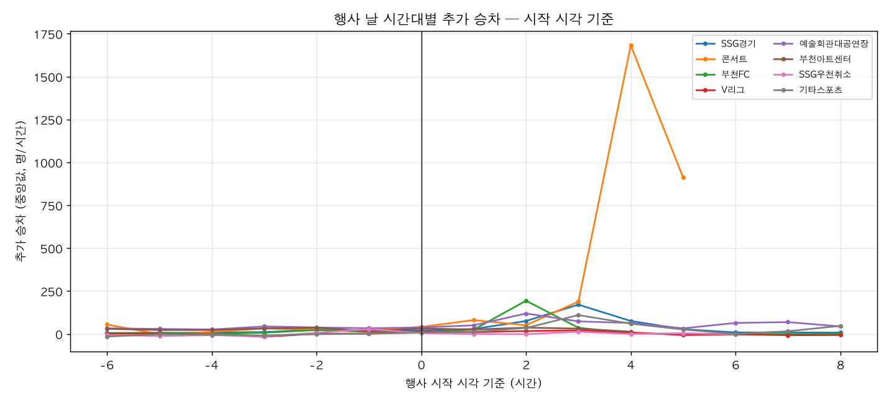
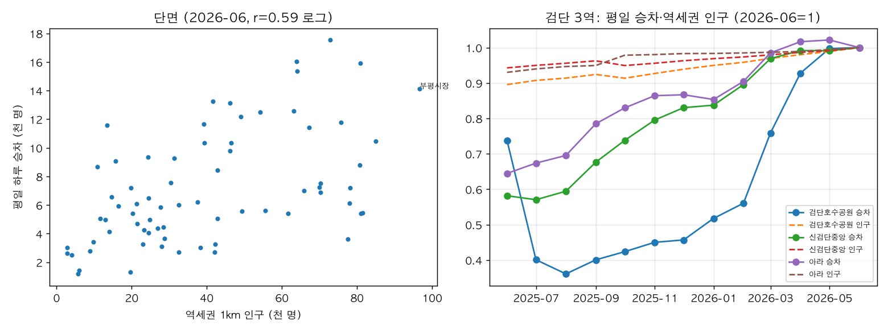

# SINCON 2026 — 모은 자료 × 지하철 승차 연결 분석

> 작성: 데이터 수집·분석 담당 / 기준일: 2026-11-12
> train(2025-01-01 ~ 2026-06-30, 71개 역 × 6~23시 승차 2.28억 명)에 지금까지 모은 자료 30여 개를 **날짜 × 역 × 시간대**로 붙여서, 무엇이 승차를 얼마나 움직이는지 숫자로 정리했어요.
> 프로그램: `analysis/deep/a1~a6_*.py` (다시 돌리면 같은 결과), 표·그림: `outputs/analysis/`
> 2026-11-12 밤 추가: 서울시 **일별** 승하차(7호선 부천·인천 9개 역 2015~2021, 환승 상대역 ~2026-06)로 본 추석 하루하루 효과, 10월 말까지 늘린 학교 휴업 비율, K-패스 '모두의 카드'

## 한눈에 보기

| 요인 | 크기 (평소 대비) | 언제·어디서 | test 기간(7~10월)에 있나 |
|---|---|---|---|
| **요일·공휴일** | 일요일 0.54배, 설·추석 0.40배, 징검다리 0.88배 | 전 역, 출근 시간대에 가장 큼 (설·추석 7시 0.10배) | 7/17, 8/17, **9/24~26 추석**, 10/5, 10/9 |
| **금·월·토 공휴일** | 금요일 공휴일 = 일요일의 **1.16배**(밤 1.3~1.5배), 월요일 공휴일 ≈ 일요일, 토요일 공휴일 = 보통 토요일의 0.89배 | 전 역 | 7/17·10/9(금), 8/17·10/5(월), 8/15·10/3(토) |
| **대형마트 의무휴업 일요일** | 동춘 −20%, 독정 −12%, 센트럴파크 −7% (대부분 역 ±2%) | 마트 가까운 역, 15~18시 | 7/12, 7/26, 8/9, 8/23, 9/13, 9/27(?), 10/11, 10/25 |
| **명절 성묘** | 부평삼거리 **설·추석 일요일의 3.5배** | 부평삼거리만 | 9/24~26 |
| **중·고 방학** | 전체 6~8시 −11~15%, 15~17시 −9~13% / **검바위 하루 −31%** (16시 −71%) | 학교 가까운 역 | **7/22 ~ 8/17** (96%가 방학인 주: 7/27~31) |
| **여름 집단휴가 주간** | 방학 효과를 빼고도 아침 승차 **추가 −10%** (마전·지식정보단지·검단오류 −15~18%) | 산업·업무 역 + 전체 | **7/27 ~ 8/7** (8/3~7 유력) |
| **콘서트** | 하루 +5,100명(중앙값), 시작 4시간 뒤 **시간당 +1,700명** | 문학·아시아드·서구청 | 흠뻑쇼 7/11, 서스테이너블 웨이브 8/29~30, PLAVE 9/12~13 (K-POP FESTA·GHOSTIVAL은 취소) |
| **SSG 경기** | 경기 뒤 2시간 추가 승차 ≈ **0.26 × 관중** (r=0.83) | 문학경기장 | 35경기 (+우천취소 4) |
| **꽃·축제·마라톤** | 하루 +450~3,400명 (부평풍물 토요일 밤 2.4배, 만화축제 1.6배) | 각 행사장 역 | BIFAN 7/2~12, 만화축제 9/18~20, **부평풍물 10/2~4**, 송도마라톤 9/20 |
| **야구장 비(非)KBO 행사** | 불꽃야구·팬 이벤트 = 큰 경기 수준 | 문학경기장 | 10/17 최광야구, 10/31 불꽃야구 |
| **공연장** | 예술회관 대공연장 밤 +18~38%, 부천아트센터 +23~26% | 예술회관, 부천시청·신중동 | 예술회관 29일, 부천아트센터 30일 |
| **비** | 시간당 1~5mm: 평일 −5%, 토 −10% / 5~10mm 일요일 −19% | 전 역 | (날씨 담당 자료) |
| **극한호우·폭설** | 2025-08-13 하루 0.88~0.93, 10~11시 −25~36% / 2025-12-04 계양 밤 7.8배 | 전 역 / 공항철도 환승역 | — |
| **역세권 인구** | 단면 상관 r=0.59, 검단 3역은 인구 +5~9%에 승차 +44~177% | 검단 3역 | **test 기간에도 인구 증가 중** (신검단중앙 6→10월 +6.6%) |
| 컨벤시아·미세먼지·버스 파업 | 거의 0 (±2%) | — | 변수로 넣을 필요 작음 |

---

## 1. 기본 구조 — 시간대·요일·역 유형

**평일 하루 승차 중 시간대 비중 (%)**
| | 7시 | 8시 | 12시 | 18시 | 19시 | 21시 | 22시 |
|---|---|---|---|---|---|---|---|
| 1호선 평일 | 11.9 | 10.9 | 4.5 | 9.8 | 4.4 | 3.3 | 2.2 |
| 2호선 평일 | 13.7 | 12.4 | 4.9 | 8.5 | 3.7 | 2.3 | 1.6 |
| 7호선 평일 | **15.5** | 14.3 | 4.1 | 8.5 | 4.1 | 2.8 | 2.1 |
| 1호선 토요일 | 3.8 | 5.4 | 7.8 | 5.8 | 4.5 | 4.1 | 3.0 |
| 1호선 일요일 | 3.0 | 4.9 | 7.7 | 5.9 | 5.0 | 4.1 | 2.7 |

- 7호선(부천·부평 → 서울 방향)이 아침 쏠림이 가장 커요. 주말은 12~15시가 가장 많아요.
- 평일 안에서도 금요일이 월요일보다 **5.6%** 많아요 (화 +2.2%, 수 +3.0%, 목 +2.8%).

**역 유형** (평일 아침 7~8시 ÷ 저녁 18~19시 승차 비중, 일요일 ÷ 평일) — `a1_station_types.csv`

| 유형 | 역 수 | 아침/저녁 | 일요일/평일 | 대표 역 |
|---|---|---|---|---|
| 주거형 (아침에 많이 탐) | 47 | 2.9 | 0.54 | 신중동, 상동, 부천시청, 작전, 부평시장 |
| 혼합형 | 15 | 1.1 | 0.50 | 예술회관, 부평, 인천시청, 서구청 |
| 업무·산업형 (저녁에 많이 탐) | 6 | 0.44 | **0.33** | 테크노파크, 인천대입구, 지식정보단지, 국제업무지구, 주안국가산단, 검단오류 |
| 여가·관광형 | 3 | 1.5 | **1.04** | 인천터미널, 문학경기장, 인천대공원 |

→ 같은 요인(공휴일·방학·휴가)이라도 **유형마다 반응이 반대**예요. 모델에 역 유형(또는 역 ID × 요인)을 꼭 같이 넣으세요.

**월별 추세** — `a1_monthly.png`
- 2026 상반기 평일 승차는 2025 상반기보다 1호선 **+12.7%** (검단 3역 개통 효과 포함), 2호선 +2.3%, 7호선 +2.9%.
- 2025-06-28(검단 개통 + 요금 1,400→1,550원) 직후 한 달, **기존 역만** 보면 1호선 −5.7%, 2호선 −6.0%, 7호선 −2.8%. 7호선은 검단과 무관한데도 −2.8% → 이게 대략 **요금 인상 + 계절** 몫이고, 1·2호선의 나머지 −3%가 검단 쪽으로 옮겨 간 몫으로 볼 수 있어요.

## 2. 달력 — 공휴일·명절·징검다리

**날 종류별 네트워크 승차 (평일 = 1)** — `a2_daykind_hour_vs_weekday.csv`
| 날 종류 | 하루 | 7시 | 8시 | 12시 | 18시 | 21시 |
|---|---|---|---|---|---|---|
| 설·추석 (당일·연휴) | **0.40** | 0.10 | 0.14 | 0.70 | 0.27 | 0.53 |
| 연휴 마지막날 | 0.52 | 0.14 | 0.21 | 0.89 | 0.35 | 0.65 |
| 일요일 | 0.54 | 0.14 | 0.24 | 0.96 | 0.34 | 0.67 |
| 공휴일(일반) | 0.58 | 0.17 | 0.25 | 0.99 | 0.38 | **0.81** |
| 근로자의날(2025) | 0.67 | 0.35 | 0.49 | 0.85 | 0.50 | — |
| 토요일 | 0.73 | 0.23 | 0.36 | 1.28 | 0.45 | 0.90 |
| 징검다리 평일 | 0.88 | 0.73 | 0.77 | 0.99 | 0.87 | 0.87 |

- 일반 공휴일은 **일요일보다 7% 많고**, 특히 밤(21시 0.81 vs 0.67)이 많아요. "공휴일 = 일요일"로 두면 공휴일 밤을 낮게 예측해요.
- 설·추석은 일요일보다도 26% 적어요. **2026 추석(9/24~26)은 목~토**라 9/27(일)까지 4일 연휴예요.

**역마다 명절 반응이 크게 달라요** (설·추석 하루 ÷ 그 역 일요일) — `a2_holiday_vs_sunday_by_station.csv`
- 가장 적은 역: 문학경기장 0.15, 부천종합운동장 0.52, 인천대공원 0.56, 상동 0.59
- 가장 많은 역: **부평삼거리 3.47** (인천가족공원 성묘), 동춘 0.94, 검단오류 0.92

**추석 하루하루 (서울시 일별 자료, 평소 같은 요일 = 1)** — `analysis/chuseok_daily_effect_seoul.csv`, 2020·2021(코로나) 제외
| | D-3 | D-2 | 전날 | 추석 | 다음날 | D+2 | D+3 |
|---|---|---|---|---|---|---|---|
| 2026 날짜 | 9/22 화 | 9/23 수 | 9/24 목 | 9/25 금 | 9/26 토 | 9/27 일 | 9/28 월 |
| 7호선 부천·인천 9개 역 (2015~2019 중앙값) | 0.98 | 0.96 | 0.42 | **0.37** | 0.48 | 0.59 | 0.95 |
| 환승 상대역 6곳 (2015~2025 중앙값) | 0.99 | 0.99 | 0.55 | 0.50 | 0.57 | 0.74 | 0.95 |
| **7호선 9개 역 2019년** (요일 배치가 2026과 같음) | 0.97 | 0.99 | 0.37 | 0.35 | 0.60 | **0.92** | 0.99 |
- 2019년 추석(9/13 금)은 2026년(9/25 금)과 요일 배치가 똑같아요. 그해 추석 다음다음 날(일)은 평소 일요일의 **0.92배** → **2026-09-27(일)은 거의 평소 일요일**로 보면 돼요. 중앙값 0.59는 연휴가 길었던 해(2017 열흘 연휴) 영향이에요.
- 인천1·2호선 역은 이 자료에 없어서, 환승 상대역(계양·검암·부평·주안·원인재) 값을 참고하세요. 상대역과 train 같은 날 승차의 일별 상관은 0.93~0.98이에요.

**긴 기간(2016~2025, 공사 월별 자료)으로 본 추석 달**
| 1호선 계절 지수 | 9월 | 10월 |
|---|---|---|
| 추석이 9월인 해 (2016, 2018, 2019, 2024) | 0.97~1.01 | 1.01~1.04 |
| 추석이 10월인 해 (2017, 2025) | 1.04~1.14 | 0.91~1.04 |
→ **2026은 추석이 9월**이라, 2025 패턴을 그대로 쓰면 9월은 높게, 10월은 낮게 예측해요.

**test 기간 공휴일의 닮은꼴** (같은 요일에 놓였던 명절 아닌 공휴일) — `analysis/deep/a7_*.py`, `outputs/analysis/a7_*.csv`
| 모양 | test 날짜 | train | 서울 일별(2015~2025) | 시간대 특징 (train) |
|---|---|---|---|---|
| **금요일 공휴일** | 7/17 제헌절, 10/9 한글날 | 일요일의 **1.16배** (평소 금요일의 0.60) · 4번 | 1.14~1.21배 | 밤 21~23시 일요일의 **1.3~1.5배**, 6~7시 1.4배 |
| **월요일 공휴일** | 8/17, 10/5 (대체) | 일요일의 **1.01배** · 5번 | 1.01~1.08배 | 7시만 1.2배, 나머지 일요일과 같음 |
| **토요일 공휴일** | 8/15 광복절, 10/3 개천절 | 보통 토요일의 **0.90배** · 2번 | 0.89배 | 아침 7~8시 0.75~0.79배 |
| 연휴 전날 (평일) | 7/16, 8/14, 10/2, 10/8 | 1.0배 · 7번 | 1.01배 | 밤 22~23시만 +6~9% |
| 월요일 공휴일 앞 일요일 | 8/16, 10/4 | 1.06배 · 3번 | 1.00배 | **밤 22~23시 +20~43%** |
| 금요일 공휴일 뒤 토요일 | 7/18, 10/10 | **0.91배** · 3번 | 0.87배 | 밤 22~23시 −16~19% |
- 제헌절(7/17)은 2008년 이후 처음 다시 공휴일이 돼서 train에 같은 날이 없어요. **금요일 공휴일 닮은꼴**(현충일 2025-06-06, 광복절 2025-08-15, 개천절 2025-10-03, 노동절 2026-05-01)을 쓰세요.
- 공통 규칙: "공휴일 = 일요일"은 **월요일 공휴일에만** 맞아요. 금요일 공휴일은 일요일보다 많고, 토요일 공휴일은 토요일보다 적어요.

**대형마트 의무휴업 일요일** (매월 둘째·넷째 일요일, 다른 세션 분석, `data/external/mart_closure_*.csv`)
- 공휴일 아닌 일요일끼리 같은 달 안에서 비교: 동춘 **−19.8%**(15~18시 약 −26%), 독정 −12.1%, 센트럴파크 −6.6%, 주안국가산단 −5.0%, 부천시청 −4.9%, 굴포천 −3.7%. 전체 역 중앙값 −1.5%.
- test: 7/12, 7/26, 8/9, 8/23, 9/13, **9/27(추석 직후라 영업 여부 불확실)**, 10/11, 10/25.

## 3. 학교 방학·여름 휴가

**중·고 방학 비율 0 → 100%일 때 네트워크 시간대별 승차 변화** (2025 여름 평일)
| 6시 | 7시 | 8시 | 9시 | 10~14시 | 15시 | 16시 | 17시 | 18~20시 |
|---|---|---|---|---|---|---|---|---|
| −10.6% | **−14.6%** | −13.9% | −2.3% | +0~3% | −9.4% | **−12.8%** | −9.9% | −6~8% |

- 등교(6~8시)·하교(15~17시)만 줄고 낮(10~14시)은 오히려 조금 늘어요 → **시간대별로 다르게** 넣어야 해요.
- 역별 하루 효과 (`a2_school_vacation_effect_station_day.csv`): **검바위 −31%**, 주안국가산단 −20%, 독정 −18%, 부평삼거리 −17%, 인천가좌 −16%, 지식정보단지·신연수·인천대입구 −14~15%
- 학교 앞 역은 **하교 시간 승차**가 가장 크게 빠져요: 검바위 16시 **−71%**, 독정 −52%, 부평삼거리 −45%.
- 2026 여름방학: 50% 넘는 날 **7/22 ~ 8/17**, 대부분 **8/18(화) 개학**.
- 2학기(9~10월, 10월 말까지 늘린 학사일정): 재량휴업이 몰리는 날은 **9/23(수) 9%, 9/28(월) 13%**뿐이에요. 추석 앞뒤 징검다리(10/6~8)는 2% 안팎이라 걱정할 수준이 아니에요. 효과는 여름방학의 약 10분의 1.

**여름 집단휴가 주간** (`a2_summer_holiday_week_am.csv`)
- 방학 비율이 75%가 넘는 날끼리 비교해도 **2025-07-28 ~ 08-08** 아침(7~8시) 승차가 다른 방학 날보다 평균 **약 10% 더 적어요** (유형 상관없이 0.89~0.90배).
- 가장 크게 준 역: 마전 0.82, 지식정보단지 0.83, 검단오류 0.84, 검단사거리 0.85, 운연 0.86.
- 경총 2026 조사: 제조업 휴가가 8월 초순 67.5%, 7월 하순 23.8% → 2026은 **7/27 ~ 8/7, 특히 8/3~7**.

## 4. 행사·경기·공연

**행사 종류별 효과** (같은 역·같은 요일유형·같은 시각, 행사 없는 날 중앙값 대비) — `a3_event_kind_summary.csv`
| 종류 | 건수(역×날) | 하루 추가 승차 중앙값 | 상위 10% | 하루 배율 | 22시 배율 |
|---|---|---|---|---|---|
| 콘서트 | 31 | **+5,107** | +11,726 | 2.37 | **21.5** |
| 꽃·계절 (대공원 벚꽃, 원미산 진달래) | 36 | +3,372 | +9,360 | 2.26 | 1.13 |
| SSG 경기 | 248 | +1,326 | +6,859 | 1.64 | 1.50 |
| 예술회관 대공연장 | 74 | +867 | +1,744 | 1.10 | 1.12 |
| 기타 스포츠 (마라톤·불꽃야구·팬 이벤트) | 13 | +631 | +6,182 | 1.14 | 1.30 |
| 축제 | 61 | +446 | +2,904 | 1.04 | 1.24 |
| 부천FC | 58 | +484 | +2,397 | 1.18 | 1.05 |
| 부천아트센터 콘서트홀 | 296 | +483 | +1,280 | 1.04 | 1.09 |
| V리그 (흥국생명·대한항공) | 124 | +186 | +1,131 | 1.02 | 1.07 |
| SSG 우천취소 | 26 | +129 | +2,907 | 1.02 | — |
| 컨벤시아 대형 전시 | 168 | **+51** | +995 | 1.02 | 0.98 |

**언제 타나** (시작 시각 기준, 추가 승차 중앙값/시간) — `a3_excess_by_hour_from_start.csv`
- 콘서트: 시작 +3시간 +189, **+4시간 +1,682**, +5시간 +912 → 끝나는 시각에 한꺼번에
- SSG: 시작 +2시간 +76, **+3시간 +171** (중앙값; 큰 경기는 아래 관중 식)
- 부천FC: 시작 **+2시간 +194** (경기가 짧아요)
- 예술회관 대공연장: 시작 +2시간 +120, +3시간 +74 (상세 페이지의 실제 시작 시각 기준. 모두 19시로 가정했을 때는 +84, +32로 흐릿했어요) / 부천아트센터: 시작 +2시간에 작은 봉우리
- 경기 **전**에 타는 사람은 거의 없어요 (승차 자료라서 도착은 하차에 나타나요)

**SSG 관중 → 경기 뒤 승차** (`a3_ssg_attendance.png`)
- 문학경기장역 경기 종료 시각부터 2시간 추가 승차 ≈ **0.263 × 관중 + 204** (r = 0.83, 124경기)
- 관중 2만 명이면 약 +5,500명, 1만 명이면 약 +2,800명.
- **우천취소**는 대부분 관중 입장 전에 결정돼서 효과가 작지만, 입장 뒤 취소되면 18시에 급증해요 (2025-06-13 하루 3.8배).

**콘서트는 옆 역에도 퍼져요**: 아시아드 콘서트 날 서구청 하루 **1.89배** (아시아드역 2.19배).

**컨벤시아는 거의 효과 없음**: 홀 2~4개를 다 쓰는 큰 전시도 중앙값 +51명. 변수로 넣어도 기대하지 마세요.

## 5. 날씨·미세먼지

**시간당 강수별 네트워크 승차 배율** (같은 역·요일유형·시각·**월** 기준, 행사 없는 날) — `a4_rain_hourly.csv`
| 시간당 강수 | 평일 | 토요일 | 일요일·공휴일 |
|---|---|---|---|
| 0 | 1.008 | 1.018 | 1.011 |
| 0~1mm | 0.990 | 0.967 | 0.978 |
| 1~5mm | **0.953** | **0.903** | 0.928 |
| 5~10mm | 0.949 | 0.881 | **0.809** |
| 10mm+ | 0.885 | — | — |
- 주말이 비에 2~3배 더 민감해요 (외출을 미룸). 평일 출퇴근은 덜 줄어요.
- 하루 강수 20~50mm인 날: 평일·토요일 −5%.
- **기온은 거의 영향 없음** (최고 체감 33℃ 이상도 ±2%). 폭염은 변수 우선순위가 낮아요.
- 날씨 자료는 Open-Meteo 재분석(ERA5)이라 국지성 호우·적설을 잘 못 잡아요. 2025-12-04 폭설은 적설 0.7cm로만 나와요 → **날씨 담당의 기상청 관측값**이 더 정확할 거예요.

**극한 날씨 두 번**
| 날짜 | 무엇 | 승차 |
|---|---|---|
| 2025-08-13 (수) | 극한호우, 1호선 박촌역 침수 11:56~14:15 무정차 | 노선별 하루 0.88~0.93배, 10~11시 −25~36%, 박촌 12~13시 0명 |
| 2025-12-04 (목) | 첫눈 폭설·대설특보, 퇴근길 교통대란 | 하루는 그대로(1.00~1.03배), **계양 19~21시 7.8배·귤현 4.7배** (도로 대신 공항철도→지하철) |

**미세먼지 (PM10, 모델 값)**: 평일·일요일은 영향 없음(±1%). '나쁨'(80+) 토요일만 0.95배인데 3일뿐이라 믿기 어려워요. 7~10월엔 '나쁨' 날이 없어서 test에는 거의 무관해요.

## 6. 인구·공항·정책

**역세권 인구**
- 71개 역 단면: log(1km 인구) ↔ log(평일 승차) 상관 **r = 0.59**. 인구만으로는 절반 정도만 설명돼요 (환승·업무지구·학교가 나머지).
- **검단 3역 (2025-08 → 2026-06)**
  | 역 | 역세권 인구 | 평일 하루 승차 |
  |---|---|---|
  | 검단호수공원 | +9.4% | 478 → 1,324 (**+177%**) |
  | 신검단중앙 | +4.6% | 3,850 → 6,480 (+68%) |
  | 아라 | +5.7% | 8,694 → 12,505 (+44%) |
  - 승차가 인구보다 훨씬 빨리 늘어요 (새 노선에 익숙해지는 효과). **아직 포화되지 않았어요** → test 기간에도 상승 추세를 이어서 예측하세요. 역세권 인구도 2026-06 → 10월 신검단중앙 +6.6%, 아라 +5.4% (다른 역은 ±1%).

**인천공항**: 계양역 평일 승차와 공항 월 여객은 상관이 오히려 음(−0.56) — 공항 이용객은 평일 출퇴근 수요에 묻혀요. 계양에서 공항 효과는 **연휴 마지막날·입국 많은 날 밤**에만 보여요 (9절 #7). 월 여객 자체를 변수로 쓰는 건 권하지 않아요.

**정책·사건**
| 사건 | 효과 |
|---|---|
| 서울 시내버스 파업 (2026-01-13~14) | 7호선 하루 +2~3%, 14일 21시 +20% — 작아요 |
| K-패스 '모두의 카드' (2026-01~), '반값' (2026-04~09) | 기존 역 평일 전년 대비 1~3월 +2.0~3.1% → 4~6월 +2.9~3.9% (약 +0.7%p, 잡음 수준). test는 7~9월 반값·10월 원래대로지만 **변수로 넣을 필요 작음** |
| 검단 개통 + 요금 인상 (2025-06-28) | 기존 역 −3 ~ −6% (위 1절) |
| 행정체제 개편 (2026-07-01), 버스 노선 개편 | train에 없어서 확인 불가 — 검단구청 개청이 검단 3역 낮 시간을 올릴 수 있음 |

## 7. 모델로 확인 — 어떤 자료가 RMSLE를 얼마나 줄이나

LightGBM(log1p 승차, 같은 설정·같은 학습 횟수)에 자료 묶음을 **하나씩 더하면서** 떼어 둔 기간의 RMSLE를 쟀어요 (`analysis/deep/a5_ablation.py`, `a5_ablation.csv`).
- **검증 A**: 2026-04~06을 떼고 그 전으로만 학습 (시간 순서 그대로 = test와 같은 상황)
- **검증 B**: 2025-07~10을 떼고 앞뒤로 학습 (여름·추석·가을이 들어 있는 기간. 대신 학습 자료에 여름이 하나도 없음)

| 단계 (누적) | 검증 A RMSLE | 줄어든 양 | 검증 B RMSLE | 줄어든 양 |
|---|---|---|---|---|
| G0 기본 (역·시각·요일·공휴일·월·추세·검단 개통) | 0.2061 | — | 0.2419 | — |
| + G1 달력 상세 (명절·징검다리·연휴 마지막날·공휴일까지 남은 날) | 0.2051 | −0.0010 | 0.2321 | **−0.0098** |
| + G2 학교 방학·휴가 주간 | 0.2053 | (0) | 0.2327 | (0) |
| + G3 **행사·경기·공연** | **0.1754** | **−0.0299** | **0.2074** | **−0.0253** |
| + G4 날씨 (시간·일) | 0.1765 | (+0.001) | 0.2056 | −0.0018 |
| + G5 역세권 인구 | 0.1720 | −0.0045 | 0.2088 | +0.0032 |
| + G6 공항 월 여객·미세먼지 | 0.1738 | +0.0018 | 0.2136 | +0.0048 |

**하나씩 뺐을 때** (검증 A, 전체 모델 0.1738 기준): 행사 빼면 **+0.0260**, 날씨 빼면 **+0.0061**, 달력 상세 빼면 +0.0025, 인구 빼면 −0.0030(오히려 좋아짐), 공항·미세먼지 빼면 −0.0018(오히려 좋아짐), 방학 빼면 −0.0005.

**읽는 법** (학습마다 ±0.002 정도는 우연한 흔들림이에요)
1. **행사·경기·공연이 압도적**: 두 검증 모두 RMSLE를 **0.025~0.030** 줄여요 (전체 개선의 70~80%). 모은 자료 중 가장 값진 묶음이에요.
2. **달력 상세는 명절·징검다리가 있는 기간에 큼**: 4~6월(A)엔 −0.001이지만 추석·징검다리가 있는 7~10월(B)엔 **−0.010**. test 기간에 추석이 있으니 B 쪽이 더 비슷해요.
3. **날씨는 '빼면 나빠지는' 쪽으로 확실**: 더할 때 효과는 흔들리지만 빼면 +0.006. 다른 변수와 겹쳐서 단독 기여가 작게 보이는 거예요. 기상청 관측값이면 더 좋아질 수 있어요.
4. **학교 방학은 이 실험으로는 0**: 검증 A(4~6월)엔 방학이 없고, 검증 B는 학습 자료에 여름방학이 없어서 트리 모델이 배울 수 없었어요. **실제 test는 2025 여름이 학습에 들어가니** 3절 숫자(등하교 −10~15%, 학교 앞 역 −30~70%)가 그대로 쓰일 거예요. 모델이 못 배우면 규칙으로 곱해 주세요.
5. **인구는 불안정**: A에선 도움(−0.0045), B에선 해(+0.0032)·빼면 오히려 좋아짐. 월 단위 값이라 '추세'와 겹쳐요. 넣는다면 **검단 3역에만** 쓰거나 추세 대신 쓰세요.
6. **공항 월 여객·미세먼지는 넣지 마세요**: 두 검증 모두 나빠져요.

**추석 날짜별 배율을 모델에 넣는 법** (검증 B, 2025 추석 포함, 배율은 2025년을 뺀 서울 일별 자료로만 계산) — `analysis/deep/a5b~a5d_*.py`
| 방법 | 7~10월 전체 RMSLE | 추석 연휴 날 | 10/1~10/12 |
|---|---|---|---|
| 기본 모델 (G0~G5) | 0.2088 | 0.401 | 0.291 |
| + 추석 변수 (D-4~D+4, 날짜별 배율) | 0.2088 (**똑같음**) | 0.401 | 0.291 |
| 공휴일 변수를 끈 '평소' 예측 × 날짜별 배율 | 0.257 (나빠짐) | 0.637 | 0.554 |
| **추석 연휴 날(공휴일)에만 × '추석 ÷ 보통 일요일' 배율** | **0.2023 (−0.0065)** | **0.280** | **0.240** |
- 변수로 넣으면 효과가 없어요. 학습 자료에 추석이 한 번도 없으면(2025-01 ~ 2026-06에는 2025 추석 하나뿐) 트리 모델은 그 변수를 쓸 수 없어요. test 학습에는 2025 추석이 한 번 들어가지만, 한 번으로 배우기엔 부족해요.
- 날짜 위치(D-3, D+3…)만 보는 배율은 해마다 연휴 모양이 달라서 틀려요. 2025년은 D-3이 개천절, D+3이 한글날이라 크게 빗나갔어요.
- **잘 맞은 방식**: 모델은 추석 연휴 날을 '공휴일(≈ 일요일)'로 예측하니, 그 위에 서울 일별 자료로 구한 **'추석 ÷ 보통 일요일'** 배율을 공휴일인 추석 날에만 곱해요.
  - 배율 (2015~2025, 코로나 제외): **전날 0.777 · 당일 0.724 · 다음날 0.852** · 대체공휴일 0.989
  - 2026: **9/24 × 0.777, 9/25 × 0.724, 9/26 × 0.852** (대체공휴일 없음). 9/27(일)은 곱하지 않아요 (2019년 같은 배치에서 평소 일요일의 0.92).
  - 파일: `data/external/chuseok_prior_daily.csv`의 `chuseok_vs_sunday_factor` (곱하는 값, 다른 날은 1)

**아직 많이 틀리는 곳** (전체 모델 기준, `a5_worst_stations_*.csv`)
- 역: 부천종합운동장 0.57 · 문학경기장 0.48 · 인천대공원 0.36 (A) / **검단호수공원 0.73** · 문학경기장 0.49 · 송도달빛축제공원 0.36 (B) → 행사장 역과 새 역
- 시각: 밤으로 갈수록 커요 (A: 7~9시 0.12~0.13 → **22~23시 0.23~0.26**). 행사 끝나는 시각과 막차 무렵이 약점이에요.

## 8. test 기간 요인 달력

`outputs/analysis/a6_test_period_driver_calendar.csv` — 2026-07-01 ~ 10-31, 하루 한 줄:
공휴일 / 연휴 / 징검다리 / 중·고 방학 비율 / 산업단지 휴가 주간 / 행사(역·시작 시각) / 공항 최다일 / 정책·날씨 / 컨벤시아

`outputs/analysis/a6_test_period_station_events.csv` — 역 × 날짜 행사 목록 (모델 입력용)

- 123일 중 **87일**에 역 단위로 알려진 행사가 있어요: SSG 35일, 축제 39일, 예술회관 29일, 부천아트센터 30일, 부천FC 10일, 콘서트 3일, 기타 스포츠 3일, 우천취소 4일. (K-POP FESTA·GHOSTIVAL은 취소돼서 뺐고, 시민의 날 대축제 10/10을 넣었어요. 예술회관은 상세 페이지의 실제 시작 시각을 써요.)

## 9. 모델 담당에게 — 우선순위

0. **추석 연휴 날 보정**: 모델 예측에 9/24 × 0.777, 9/25 × 0.724, 9/26 × 0.852 (검증에서 RMSLE −0.0065, 추석 날 0.40 → 0.28).
1. **달력 + 역별 반응**: 공휴일을 일요일로 두지 말 것(밤 +20%), 설·추석은 일요일보다 −26%, **부평삼거리 명절 3.5배**, 추석 9월 → 9·10월 수준 조정. 추석 하루하루는 2019년(같은 요일 배치)을 본보기로: 9/24 0.37 · 9/25 0.35 · 9/26 0.60 · **9/27 0.92** (평소 같은 요일 대비).
2. **학교 방학 비율을 시간대별로**: 등하교 시간만 −10~15%, 학교 앞 역(검바위·독정·부평삼거리)은 −30~70%.
3. **여름 휴가 주간 7/27~8/7**: 아침 추가 −10%, 산업·업무 역 −15%.
4. **콘서트·SSG·꽃·축제**: 시작 시각 기준으로 끝나는 시간대에 몰아서. SSG는 관중 × 0.26.
5. **검단 3역 상승 추세** 이어가기.
6. **비**: 시간당 1mm 넘으면 주말 −10% 이상.
7. 컨벤시아·미세먼지·공항 월 여객·버스 파업·K-패스는 넣어도 거의 도움이 안 돼요.
8. **공휴일 요일별로 다르게**: 금요일 공휴일(7/17, 10/9)은 일요일 × 1.16, 밤은 × 1.3~1.5 / 토요일 공휴일(8/15, 10/3)은 토요일 × 0.9.
9. **대형마트 의무휴업 일요일**은 역별 변수로 (동춘·독정·센트럴파크만 의미 있음).
